# Project Guide: Hallucination Guardrails via MFA and EVT

This is a complete, self-contained walkthrough of the project: what problem it solves, what data it uses, every concept it relies on, how each piece is implemented in the code, what the results mean, and the questions you are likely to be asked about it. Read it top to bottom once; afterwards each section works as a reference.

> **Viewing tip.** The diagrams are written in Mermaid. They render automatically on GitHub and in VS Code's Markdown preview (with the "Markdown Preview Mermaid Support" extension).

---

## Contents

1. [The project in one minute](#1-the-project-in-one-minute)
2. [The problem: why RAG systems hallucinate](#2-the-problem-why-rag-systems-hallucinate)
3. [The solution at a glance](#3-the-solution-at-a-glance)
4. [The data](#4-the-data)
5. [Concepts, one by one](#5-concepts-one-by-one)
6. [How the code is organised](#6-how-the-code-is-organised)
7. [Implementation walkthrough](#7-implementation-walkthrough)
8. [Experiments and how they are run](#8-experiments-and-how-they-are-run)
9. [Results and how to read them](#9-results-and-how-to-read-them)
10. [Limitations and honest takeaways](#10-limitations-and-honest-takeaways)
11. [Likely viva / review questions](#11-likely-viva--review-questions)
12. [Glossary](#12-glossary)

---

## 1. The project in one minute

- **What:** a *pre-retrieval guardrail* for a Retrieval-Augmented Generation (RAG) chatbot that answers questions about seven companies' SEC 10-K annual reports.
- **Why:** a RAG system retrieves "the closest" text for *any* question, even one its documents cannot answer (e.g. *"Who painted the Mona Lisa?"*). The LLM then often answers anyway, which is a hallucination: an answer not grounded in the knowledge base.
- **How:** before retrieval, the question's embedding is compared to a statistical model of what in-domain text looks like.
  1. A **Mixture of Factor Analyzers (MFA)** models the density of the corpus embeddings (written from scratch, trained with EM).
  2. A question gets a **Mahalanobis distance** to the nearest mixture component, computed cheaply with the **Woodbury identity**.
  3. **Extreme Value Theory (EVT)** converts that distance into a p-value S(q) by modelling the *tail* of distances with a Weibull distribution.
  4. If S(q) < α, the question is refused ("Query outside knowledge base"); otherwise normal RAG runs.
- **Headline results:** off-topic (Far-OOD) questions are caught almost perfectly (AUROC 1.000). Tricky in-domain-sounding but unanswerable (Near-OOD) questions are much harder (AUROC 0.858), and simpler baselines do as well or better there. Scoring takes 0.27 ms per query (p95). With a plain RAG prompt, the guardrail cuts hallucinations on OOD questions from 39% to 7% (or 2.5% with question calibration).

---

## 2. The problem: why RAG systems hallucinate

A RAG system has two parts: a **retriever** that finds the chunks of the document collection most similar to the question, and a **generator** (an LLM) that writes an answer using those chunks as context.

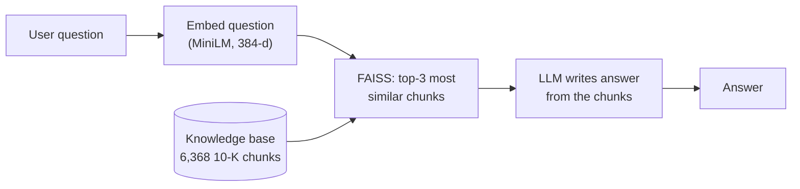

The weakness: **the retriever always returns something.** Nearest-neighbour search has no notion of "nothing relevant exists". Ask about the Mona Lisa and you still get the three 10-K chunks that happen to be closest. The LLM then either:

- answers from its own memory (correct or not, the answer is *ungrounded*), or
- stitches the irrelevant context into a confident fabrication. Real example from this project: *"Amazon recognized $3.88 billion in goodwill upon completing the acquisition of Target Corporation in 2024"* (no such acquisition exists).

**Out-of-distribution (OOD)** questions are the ones outside the knowledge base's scope. The project distinguishes two kinds:

| Kind | Example | Why it is hard |
|---|---|---|
| **Far-OOD** | "The character Wario was first introduced in which Mario game?" | Easy: completely different topic and vocabulary. |
| **Near-OOD** | "What was Apple's total net revenue from the Apple Car Titan project in fiscal 2024?" | Hard: same companies, same financial vocabulary, but asks about something that does not exist in the filings. |

A **pre-retrieval** guardrail decides *before* retrieval and generation whether the question is in scope. Benefits: refused questions cost no LLM call, and the refusal is deterministic (it does not depend on the LLM obeying a prompt).

---

## 3. The solution at a glance

There are two phases: an **offline** phase that builds the statistical model once, and an **online** phase that runs for each question.

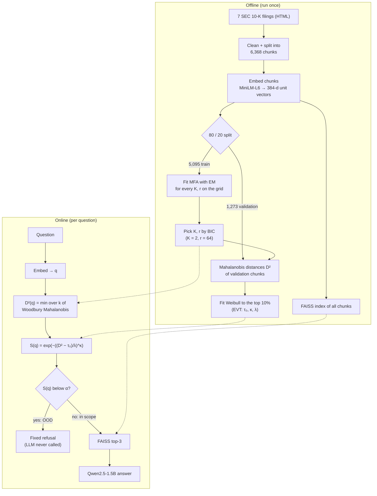

Intuition in three sentences:

1. Embeddings of in-domain text form a few dense, elongated clouds in 384-d space; the MFA describes each cloud's centre and shape.
2. The Mahalanobis distance measures how far a question lies from the nearest cloud *in units of that cloud's spread*, so stretching along directions where the data naturally varies is cheap and stretching across them is expensive.
3. EVT tells us how unusual a given distance is, by modelling just the extreme end of the distances seen on held-out in-domain data, which turns "distance 1,100" into a calibrated statement like "only 0.5% of in-domain text is this far out".

---

## 4. The data

### 4.1 Knowledge base: seven 10-K filings

A **10-K** is the annual report every US public company files with the SEC. It describes the business, risk factors, legal proceedings, financial statements and more. The corpus contains the latest 10-K of:

| Ticker | Company | Fiscal year |
|---|---|---|
| AAPL | Apple Inc. | 2025 |
| MSFT | Microsoft Corp. | 2026 |
| GOOGL | Alphabet Inc. | 2025 |
| NVDA | NVIDIA Corp. | 2026 |
| AMZN | Amazon.com Inc. | 2025 |
| META | Meta Platforms Inc. | 2025 |
| TSLA | Tesla Inc. | 2025 |

The raw files are inline-XBRL HTML pages downloaded from SEC EDGAR, stored in `data/raw/*.htm` (1.5–8.6 MB each).

### 4.2 From HTML to chunks (`src/data_pipeline.py`)

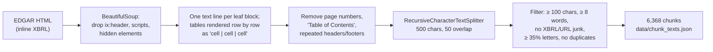

Key decisions:

- **Inline XBRL** files embed a large hidden machine-readable header (`ix:header`); left in, it would produce thousands of junk chunks full of tags like `us-gaap:Revenue`.
- **Running headers** (e.g. a company name repeated at the top of each page) are detected as short lines that occur ≥ 5 times and removed.
- **Chunking:** `RecursiveCharacterTextSplitter` tries to split on paragraph breaks first, then lines, then sentences, then words, so chunks end at natural boundaries. 500 characters ≈ 80–100 words. The 50-character overlap keeps sentences that straddle a boundary retrievable.
- **Filters** drop fragments with too little language (numbers-only table rows, link lists).

Each chunk is a JSON record:

```json
{"chunk_id": "AAPL_chunk_00012", "ticker": "AAPL", "company": "Apple Inc.",
 "year": "2025", "text": "...", "char_count": 431}
```

An earlier version of the pipeline (regex HTML stripping plus aggressive filters) kept only 2,534 chunks; the rewrite produces 6,368 chunks (mean 360 characters).

### 4.3 Embeddings (`src/embeddings.py`)

- Model: `sentence-transformers/all-MiniLM-L6-v2`, a small (22M-parameter) sentence encoder that maps any text to a **384-dimensional** vector.
- Vectors are **L2-normalised** (length 1), so the dot product of two vectors equals their cosine similarity.
- Files: `data/corpus_embeddings.npy` (6,368 × 384), `data/query_embeddings.npy` (350 × 384).

### 4.4 Train / validation split

The 6,368 chunk embeddings are split at random (seed 0) into **5,095 train** (80%) and **1,273 validation** (20%), saved in `data/train_val_split.npz`.

- **Train** chunks fit the MFA (and every baseline).
- **Validation** chunks are never seen by the MFA; their distances calibrate the EVT tail and the baselines' thresholds. This separation matters: distances of training points are optimistically small, so a threshold fitted on them would reject too much.

### 4.5 Test questions (`data/test_queries.json`, 350 total)

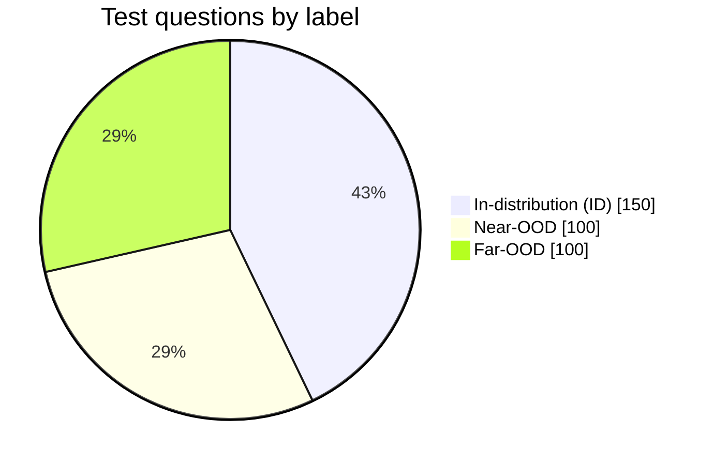

| Label | Count | Example | Expected behaviour |
|---|---|---|---|
| `IN_DISTRIBUTION` | 150 | "What are Apple's principal products and services disclosed in Item 1 of Form 10-K?" | pass to retriever |
| `NEAR_OOD` | 100 | "How much profit did Apple report from its holographic eyewear subscription service?" | reject |
| `FAR_OOD` | 100 | "Which of these African regions does not directly border the Democratic Republic of the Congo?" | reject |

Each record looks like `{"query_id": "ID_0001", "query_text": "...", "label": "IN_DISTRIBUTION", "target_company": "AAPL", "expected_behavior": "PASS_TO_RETRIEVER"}`. The individual sets are also in `data/id_queries.json`, `data/near_ood.json` and `data/far_ood.json`. Far-OOD questions come from an Open-Trivia-DB-style source (`far_ood_raw.json` is the unfiltered list).

### 4.6 Synthetic questions (ablation only)

`src/synthetic_queries.py` uses **doc2query** (`doc2query/msmarco-t5-base-v1`, a T5 model trained to write the search query a passage answers) to generate 12,668 questions from the chunks (`data/synthetic_queries.json`, embeddings in `data/synthetic_query_embeddings.npy`). Questions from training chunks fit an alternative "query-fit" MFA; questions from validation chunks calibrate its EVT. This tests the **query–passage asymmetry** hypothesis (section 5.10).

### 4.7 Data file map

| File | Contents |
|---|---|
| `data/raw/*_10K.htm` | 7 raw filings |
| `data/chunk_texts.json` | 6,368 chunks with metadata |
| `data/corpus_embeddings.npy` | chunk embeddings, 6,368 × 384 |
| `data/test_queries.json` | 350 labelled test questions |
| `data/query_embeddings.npy` | their embeddings, 350 × 384 |
| `data/train_val_split.npz` | train / validation indices |
| `data/validation_distances*.npy` | D² of validation points (passage-fit and query-fit) |
| `data/synthetic_queries.json`, `..._embeddings.npy` | doc2query ablation data |

---

## 5. Concepts, one by one

Each concept below has three parts: **intuition**, **the maths**, and **where it lives in the code**.

### 5.1 Embeddings and cosine similarity

**Intuition.** A sentence encoder places texts with similar meaning close together. "Apple's iPhone revenue" and "sales of Apple smartphones" end up near each other; "Grumpy Cat's real name" ends up far away.

**Maths.** For unit vectors, cosine similarity is cos(a, b) = a·b ∈ [−1, 1]. FAISS `IndexFlatIP` computes exact inner products against every stored vector and returns the top-k.

**Code.** `src/embeddings.py: embed()`; `src/guardrail.py: FaissRetriever`; baseline `src/baselines.py: CosineFAISS` (OOD score = 1 − max cosine to any chunk).

### 5.2 The multivariate Gaussian and Mahalanobis distance

**Intuition.** Euclidean distance treats every direction equally. But data clouds are elongated: points naturally spread a lot in some directions and very little in others. The **Mahalanobis distance** rescales each direction by how much the data varies along it. A point 2 units away along a "long" axis is ordinary; 2 units along a "thin" axis is extreme.

**Maths.** A Gaussian with mean μ and covariance Σ has density

```
N(x | μ, Σ) = (2π)^(−d/2) |Σ|^(−1/2) exp( −½ (x − μ)ᵀ Σ⁻¹ (x − μ) )
D²_M(x) = (x − μ)ᵀ Σ⁻¹ (x − μ)          (squared Mahalanobis distance)
```

If x truly comes from N(μ, Σ), then D²_M follows a χ² distribution with d degrees of freedom (mean d = 384). Real embeddings are not exactly Gaussian, which is one reason the project calibrates the threshold empirically with EVT rather than using χ² quantiles.

**Code.** `src/woodbury.py: WoodburyFactor.mahalanobis_sq()`.

### 5.3 Gaussian mixture models (GMMs) and why full covariance is expensive

**Intuition.** One Gaussian is one cloud. Text from different topics (risk factors vs. revenue tables vs. legal proceedings) forms several clouds, so we use a **mixture** of K Gaussians:

```
p(x) = Σₖ πₖ N(x | μₖ, Σₖ),     πₖ ≥ 0,  Σₖ πₖ = 1
```

**The cost problem.** A full covariance Σₖ in d = 384 dimensions has d(d+1)/2 = 73,920 free numbers *per component*. Estimating it needs a lot of data, inverting it costs O(d³), and with few points it is singular. The two classic shortcuts are both poor:

- **Diagonal covariance** (`DiagGMM` baseline): only d variances; ignores all correlations between dimensions.
- **Spherical / K-Means** (`KMeansEuclidean` baseline): one variance; ignores shape entirely.

The MFA sits in between.

### 5.4 Factor analysis and the Mixture of Factor Analyzers

**Intuition.** Even though embeddings live in 384 dimensions, most of the variation within one topic cluster lies along a few dozen directions (a low-dimensional "manifold"). **Factor analysis** says: each point is the cluster centre, plus a combination of r ≪ d hidden "factors", plus small independent noise per dimension.

**Generative story** (how the model imagines data is produced):

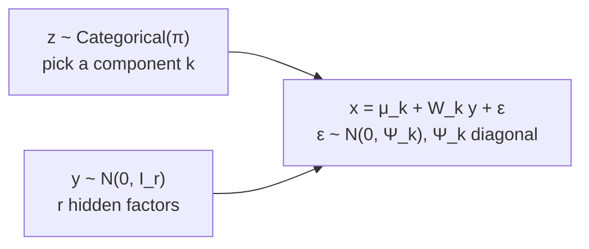

Integrating out y gives each component a covariance of a special form:

```
Σₖ = Wₖ Wₖᵀ + Ψₖ          Wₖ: d × r "factor loadings",   Ψₖ: diagonal d × d
p(x) = Σₖ πₖ N(x | μₖ, Wₖ Wₖᵀ + Ψₖ)
```

- **Wₖ Wₖᵀ** (rank r) captures the r strongest correlated directions of the cluster.
- **Ψₖ** gives every dimension its own leftover noise variance, so Σₖ is always invertible.

**Parameter count per component:** d·r − r(r−1)/2 (loadings, minus a rotation that cannot be identified) + d (Ψ) + d (μ). For the selected model (d = 384, K = 2, r = 64): **46,657 parameters in total vs 148,609 for a full-covariance GMM** (−69%).

**Code.** `src/mfa.py: class MFA`.

### 5.5 Expectation–Maximisation (EM) for the MFA

**Intuition.** If we knew which component generated each point and the hidden factors y, fitting would be ordinary regression. We know neither, so EM alternates:

- **E-step:** given the current parameters, compute *soft* guesses of the hidden quantities: the responsibility γᵢₖ (probability that point i came from component k) and the expected factors E[y | x, k].
- **M-step:** given those guesses, re-estimate π, μ, W, Ψ in closed form.

Each round can only increase (never decrease) the data log-likelihood; that is EM's key guarantee, and the unit tests check it.

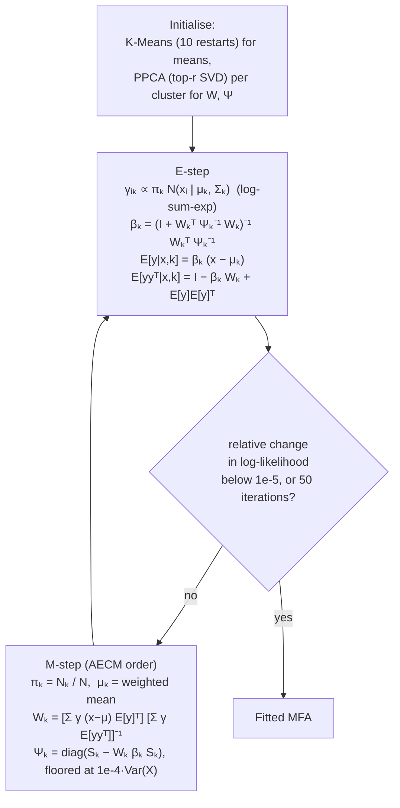

Implementation details worth knowing:

- **log-sum-exp:** densities in 384-d are astronomically small (log p ≈ +1,000s or −1,000s), so responsibilities are computed in log space: γ = exp(log πₖ + log Nₖ − logsumexp(...)).
- **AECM ordering:** π and μ are updated first, then W and Ψ are updated around the *new* mean. This is the "Alternating ECM" variant, which keeps the monotone-likelihood guarantee.
- **Ψ floor:** each noise variance is kept ≥ 1e-4 × the data variance of that dimension, so a component can never collapse onto a flat subspace (which would make the likelihood infinite).
- **No d × d matrix is ever formed.** All statistics are N × r or d × r products, so each iteration costs O(N·d·r).

**Code.** `MFA._init_params`, `MFA.e_step`, `MFA.m_step`, `MFA.fit` in `src/mfa.py`.

### 5.6 The Woodbury identity: fast inverse and determinant

**Intuition.** We need Σₖ⁻¹ and log|Σₖ| for every component, both in EM and at query time. Inverting a 384 × 384 matrix is O(d³). But Σ = WWᵀ + Ψ is "diagonal + low rank", and for such matrices the inverse can be computed by inverting only an r × r matrix.

**Maths.**

```
Woodbury:          Σ⁻¹ = Ψ⁻¹ − Ψ⁻¹ W (I_r + Wᵀ Ψ⁻¹ W)⁻¹ Wᵀ Ψ⁻¹
Det. lemma:        log|Σ| = Σⱼ log ψⱼ + log|I_r + Wᵀ Ψ⁻¹ W|
Let M = I_r + Wᵀ Ψ⁻¹ W = L Lᵀ (Cholesky).  Then log|M| = 2 Σᵢ log Lᵢᵢ  and, with δ = x − μ:
D²(x) = δᵀ Ψ⁻¹ δ  −  ‖ L⁻¹ Wᵀ Ψ⁻¹ δ ‖²
```

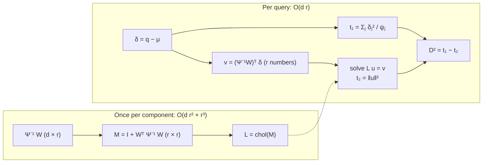

**Payoff in this project:** guardrail scoring takes **0.16 ms (p50) / 0.27 ms (p95)** per query, against **134 ms** for building and inverting Σ every time. (Pre-computing dense 384 × 384 inverses once is about as fast per query at this size; Woodbury's real advantages here are 6× less memory and never forming d × d matrices during EM. Both grow with d and K.)

**Code.** `src/woodbury.py: WoodburyFactor.build`, `.mahalanobis_sq`, `.log_pdf`, `.posterior_beta`; `naive_mahalanobis_sq` is the slow reference used in the latency test. `tests/test_core.py::test_woodbury_matches_dense` checks agreement with dense algebra to 1e-13.

### 5.7 Model selection with BIC

**Intuition.** More components (K) and higher rank (r) always fit the training data better, but past some point the model memorises noise. The **Bayesian Information Criterion** penalises the number of parameters p:

```
BIC = −2 · log-likelihood + p · ln(N)        (lower is better)
```

The project fits an MFA for every K ∈ {2, 4, 8, 16} × r ∈ {8, 16, 32, 64} (16 fits) and picks the lowest BIC. For passages: **K = 2, r = 64** (EM converged in 20 iterations, 5.9 s). The original grid stopped at r = 32 but BIC was still improving there, so r = 64 was added. Because the winner is on the edge of the grid, an even higher r might be better still.

**Code.** `MFA.n_parameters`, `MFA.bic`; `run_experiments.bic_grid`; figure `results/bic_heatmap.png`; test `test_bic_prefers_true_k`.

### 5.8 Extreme Value Theory (EVT): from distance to p-value

**The question.** Given a distance D²(q), how do we choose the rejection threshold? An empirical percentile of validation distances (e.g. the 99th) works but is noisy at the extremes: with 1,273 validation points only ~13 lie beyond the 99th percentile. EVT gives a principled model of the far tail.

**The theorem (intuition).** The **Pickands–Balkema–de Haan theorem** says that for almost any distribution, the *excesses over a high threshold* (how far points go past it) follow approximately a Generalized Pareto distribution, whatever the shape of the bulk. So we ignore the bulk and model only the tail. This is the **peaks-over-threshold (POT)** method. The project uses a **Weibull** distribution for the excesses, as in the proposal; with fitted shape κ ≈ 1 it reduces to an exponential tail, which is also what a Generalized Pareto fit gives (ξ ≈ 0.02 ≈ 0), so the two agree.

**Procedure.**

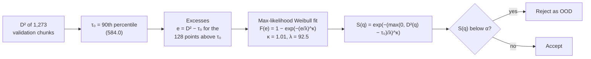

- **S(q)** is the Weibull **survival function**: the probability that an in-distribution point's excess is at least as large as q's. Read it as a **p-value** under the null hypothesis "q is in-distribution". Strictly it is *conditional on being in the tail*; the unconditional p-value is 0.10 × S(q) (`WeibullTail.unconditional_pvalue`).
- **Threshold in distance units:** solving S = α gives D* = τ₀ + λ(−ln α)^(1/κ). For α = 0.01: **D* ≈ 1,003**.
- **EVT never changes the ranking of queries** (S is a monotone function of D²), so AUROC/AUPR are identical with or without it. EVT only decides *where to cut*.

**Checking the fit.** A Kolmogorov–Smirnov (KS) test compares the excesses to the fitted Weibull. The plain KS p-value (0.49) is too optimistic, because κ and λ were estimated from the same data. `WeibullTail.bootstrap_ks_pvalue` fixes this with a **parametric bootstrap**: simulate 2,000 samples from the fitted Weibull, *refit* each, and see how often the KS statistic is as large as the observed one. Result: **p = 0.08**, so the fit is adequate (not rejected at 5%) but not tight. The Q–Q plot is `results/evt_qq.png`.

**Code.** `src/evt.py: WeibullTail.fit`, `.survival`, `.threshold`, `.bootstrap_ks_pvalue`, `compute_ood_score`.

### 5.9 Question calibration (cross-fitting)

**Problem found during the project.** ID *questions* have systematically larger D² than ID *passages* (median 498 vs 379), because the MFA was fitted on passages and questions are phrased differently. So the passage-calibrated threshold D* = 1,003 lies above every ID question (good: 100% pass) but also above nearly all Near-OOD questions (bad: only 1% rejected).

**Fix tested.** Calibrate the Weibull tail on ID *questions* instead. With no separate pool of real questions, the 150 ID test questions are split into 3 folds; each question is scored by a tail fitted on the other two folds (**cross-fitting**, so no question is scored by a model that saw it). Here τ₀ is the median, so α = 0.1 means an expected 5% false-rejection rate. Result: **95.3% of ID pass** (nominal 95%), **47% of Near-OOD and 100% of Far-OOD are rejected**.

**Code.** `run_experiments.cross_fitted_question_evt`.

### 5.10 Query–passage asymmetry

Search questions ("what was X's revenue") and document passages ("Revenue increased 8% to ...") have different style and length, so their embeddings occupy shifted regions. The query-fit ablation tried to fix this by fitting on doc2query synthetic questions. It made things **worse**, because doc2query (trained on MS MARCO web search) writes short, generic questions whose density also covers trivia. The shift is real, but generic synthetic questions are the wrong cure.

### 5.11 Evaluation metrics

Convention throughout the code: **OOD = positive class (label 1)**, and **higher score = more OOD**.

| Metric | Meaning | Ideal |
|---|---|---|
| **AUROC** | Probability that a random OOD question gets a higher score than a random ID question. Threshold-free. | 1.0 (0.5 = random) |
| **AUPR-OOD / AUPR-ID** | Area under the precision–recall curve with OOD (or ID) as positive. | 1.0 |
| **FPR@95%TPR** | Set the threshold so 95% of ID questions are accepted; report the fraction of OOD questions *still accepted*. | 0.0 |
| **Operating point** | At a concrete threshold: ID pass rate, Near-OOD rejection, Far-OOD rejection. | 1.0 / 1.0 / 1.0 |
| **Latency** | Milliseconds per query (p50 / p95 / p99 over 1,000 queries). | < 10 ms target |

Metrics are reported three ways: ID vs all OOD, ID vs Near-OOD only, ID vs Far-OOD only (`metrics.split_metrics`).

### 5.12 Downstream evaluation: faithfulness and hallucination rate

- **Generator:** `Qwen/Qwen2.5-1.5B-Instruct`, run locally on CPU with greedy decoding (deterministic). It replaced GPT-4o-mini from the proposal because no API key was available.
- **Two system prompts:**
  - *strict*: "answer only from the context; otherwise reply exactly 'I don't have information about this.'"
  - *naive*: "use the provided context to answer" (no permission to abstain). This is the common default template and the case a guardrail is meant to protect.
- **Faithfulness (Ragas-style, judged by NLI):** split the answer into sentences ("claims"); a claim is supported if a **Natural Language Inference** model (`cross-encoder/nli-deberta-v3-base`) says a retrieved chunk *entails* it with probability > 0.5. Faithfulness = supported claims / claims.
- **Hallucination rate (OOD):** fraction of OOD questions that receive a substantive (non-refusing) answer. The knowledge base cannot support any answer to these, so every substantive answer is ungrounded by construction. Refusals are detected by a regular expression (`hallucination_eval.ABSTAIN_RE`).
- **Why "guarded" is simulated cheaply:** the LLM is deterministic, so a guarded run gives exactly the unguarded answer for every passed question and the fixed refusal for every blocked one. The code therefore generates each answer once and applies the guardrail's decisions afterwards.

---

## 6. How the code is organised

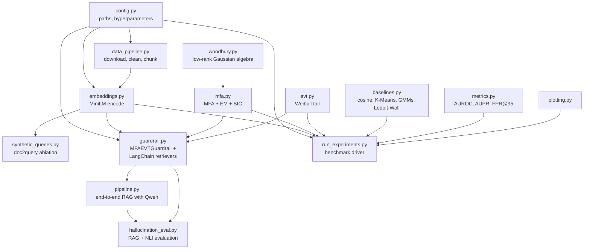

| Folder | What is there |
|---|---|
| `src/` | all library code (above) |
| `notebooks/` | `01_data_pipeline`, `02_mfa_training`, `03_evt_calibration`, `04_benchmarking`, `demo`: executed walkthroughs of each stage, generated by `scripts/build_notebooks.py` |
| `results/` | metrics CSVs, `summary.json`, `evt_params.json`, plots, saved models in `results/models/` |
| `report/` | `final_report.md` (source), `final_report.pdf`, `build_report.py` (Markdown → PDF with ReportLab) |
| `tests/test_core.py` | unit tests: Woodbury vs dense, EM monotone, BIC finds true K, save/load, EVT maths, FPR@95 |
| root | `proposal.md/.pdf`, `README.md`, `requirements.txt`, `workflow_diagram.png` |

---

## 7. Implementation walkthrough

### 7.1 `src/woodbury.py`

`WoodburyFactor.build(mu, W, psi)` pre-computes `inv_psi`, `W_ipsi = Ψ⁻¹W`, the Cholesky factor `L` of `M = I + WᵀΨ⁻¹W`, and `log_det`. Then:

- `mahalanobis_sq(X)` — the two-term formula in 5.6, vectorised over many rows (`einsum` for term 1, one triangular solve for term 2). Clipped at 0 to absorb rounding.
- `log_pdf(X)` — `−½(d·ln 2π + log|Σ| + D²)`.
- `posterior_beta()` — β = M⁻¹WᵀΨ⁻¹ (= WᵀΣ⁻¹), needed by the E-step, via `cho_solve`.
- `precision()` — dense Σ⁻¹, used only in tests.

### 7.2 `src/mfa.py`

`MFA(n_components, rank, max_iter=50, tol=1e-5, psi_floor_eps=1e-4)` is a dataclass holding hyperparameters and fitted arrays: `weights_ (K)`, `means_ (K, d)`, `loadings_ (K, d, r)`, `psis_ (K, d)`.

- `_init_params` — K-Means, then for each cluster a PPCA solution: SVD of the centred points, loadings = top-r singular vectors scaled by √(eigenvalue − average leftover variance), Ψ = remaining diagonal variance.
- `e_step` — `_log_resp` builds an N × K matrix of log πₖ + log N(x | k); `logsumexp` normalises it.
- `m_step` — the closed-form updates of 5.5 per component. `W_new = SB · Eyy⁻¹` is computed with `np.linalg.solve` rather than an explicit inverse.
- `fit` — init → loop (E-step, convergence check, M-step) → final log-likelihood. Stores `log_likelihood_history_` (plotted in `results/em_loglik.png`).
- Scoring: `score_samples` (log p(x)), `mahalanobis_all` (N × K), `min_mahalanobis` (the guardrail score), `predict`.
- `n_parameters`, `bic`, `save` / `load` (`.npz`).

### 7.3 `src/evt.py`

`WeibullTail` dataclass (`tau0, kappa, lam, tail_percentile, n_exceed, ks_stat, ks_pvalue`):

- `fit(distances, tail_percentile=90)` — τ₀ by percentile, excesses, `scipy.stats.weibull_min.fit(E, floc=0)` (location fixed at 0 so only shape κ and scale λ are estimated), plus a KS test.
- `survival(d)` — S(q); equals 1 for anything at or below τ₀.
- `threshold(alpha)` — D*.
- `bootstrap_ks_pvalue` — the Lilliefors-type bootstrap from 5.8.
- `save` / `load` — JSON (`results/models/evt_selected.json`).

### 7.4 `src/guardrail.py`

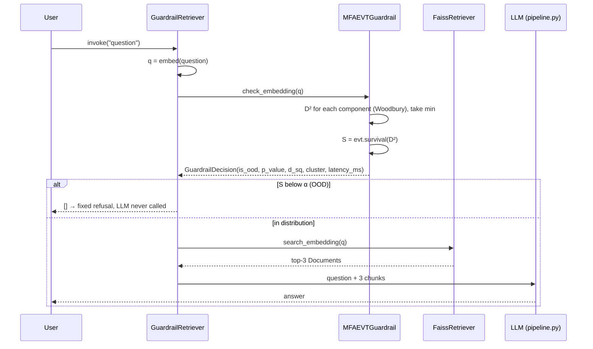

- `MFAEVTGuardrail` — loads `mfa_selected.npz` + `evt_selected.json`; `check(query)` returns a `GuardrailDecision`.
- `FaissRetriever` and `GuardrailRetriever` subclass LangChain's `BaseRetriever`, so the guardrail drops into any LangChain RAG chain. The guardrail reuses the query embedding for FAISS search, so the question is embedded only once.

### 7.5 `src/pipeline.py`

`RAGPipeline(guarded=True)` wires the retriever to `generate_answer`, which builds a chat prompt (`[1] chunk ... [2] chunk ...` + question) and runs Qwen greedily. Run it directly:

```bash
python -m src.pipeline "What are the main risk factors for Tesla's vehicle production?"
python -m src.pipeline "Who painted the Mona Lisa?"
```

### 7.6 `src/baselines.py`

All baselines expose `fit(X)` and `score(Q)` (higher = more OOD): `CosineFAISS`, `KMeansEuclidean`, `DiagGMM`, `FullGMM`, `LedoitWolfMahalanobis` (single Gaussian with a shrinkage covariance estimate). Each is fitted on the same training split with K = the BIC-selected K.

---

## 8. Experiments and how they are run

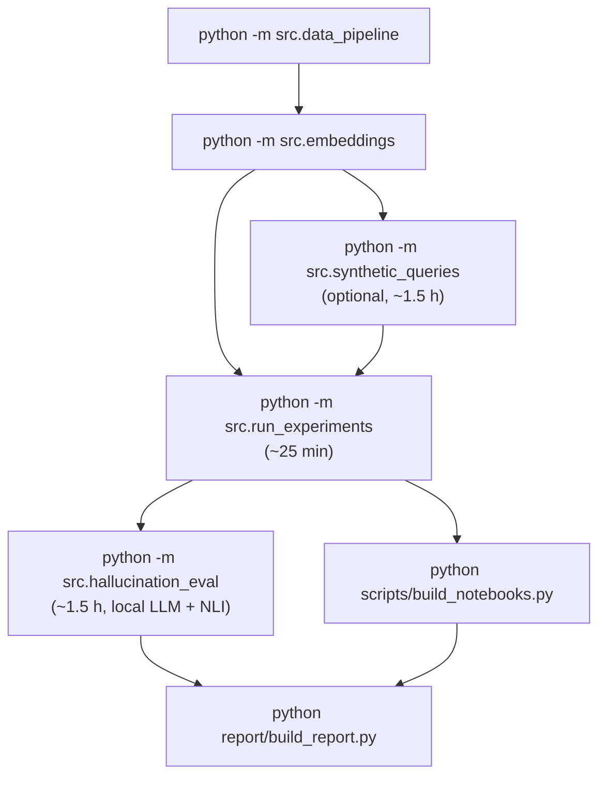

`run_experiments.py` does, for each fitting source (passage-fit, then query-fit):

1. **BIC grid** over K × r → choose the best MFA; save it.
2. **EVT:** validation D² → fit `WeibullTail`; save it.
3. **Score** the 350 test questions with the MFA (min-D² and negative log-likelihood) and every baseline.
4. **Metrics** (AUROC, AUPR, FPR@95) for All / Near / Far → `results/ood_metrics.csv`.
5. **Operating points:** EVT at α ∈ {0.01, 0.1, 0.5}; each baseline at its 99th validation percentile; the cross-fitted question-calibrated EVT → `results/operating_points.csv`.
6. **Plots:** BIC heatmap, EM log-likelihood, ROC/PR curves, score distributions, Q–Q, AUROC bars.
7. **Latency profile** (1,000 queries) → `results/latency_report.csv`.
8. `results/summary.json` with all key numbers; per-query scores in `results/query_scores.csv`.

`hallucination_eval.py` generates answers (cached and resumable in `results/rag_generations*.jsonl`), scores them with NLI, applies three conditions (unguarded, guarded α = 0.01, question-calibrated α = 0.1) and writes `results/rag_comparison.csv`, `rag_eval_summary.json` and `rag_eval_per_query.csv`.

Run the tests with `python -m pytest -q`.

---

## 9. Results and how to read them

### 9.1 Detection (passage-fit, the main setting)

| Method | AUROC all | AUROC Near | AUROC Far | FPR@95 all ↓ |
|---|---|---|---|---|
| **MFA + EVT (proposed)** | 0.929 | 0.858 | 1.000 | 0.250 |
| MFA neg. log-likelihood | 0.932 | 0.864 | 1.000 | 0.230 |
| Cosine NN (FAISS) | 0.947 | 0.894 | 1.000 | 0.160 |
| K-Means Euclidean | 0.926 | 0.853 | 0.999 | 0.325 |
| Diagonal GMM | 0.932 | 0.865 | 0.999 | 0.260 |
| Full-cov GMM | **0.962** | **0.924** | 1.000 | **0.140** |
| Single Gaussian (Ledoit–Wolf) | 0.960 | 0.920 | 1.000 | 0.180 |

How to read it:

- **Far-OOD is solved** by every method (AUROC ≥ 0.999).
- **Near-OOD separates the methods.** The MFA ties the diagonal GMM and K-Means and is beaten by cosine NN and the full-covariance models. With N ≈ 5,000 points and d = 384, a full covariance *is* estimable, so the MFA's main advantage (stability when data is scarce relative to d) does not show at this scale.
- **Likelihood beats distance:** scoring by −log p(q) (which also uses the log-determinant and mixture weights) is consistently better than min-D².

### 9.2 Operating points

| Rule | ID pass ↑ | Near-OOD rejected ↑ | Far-OOD rejected ↑ |
|---|---|---|---|
| **MFA + EVT, S < 0.01 (proposal)** | 1.000 | 0.01 | 0.89 |
| MFA + EVT, S < 0.1 | 0.993 | 0.16 | 0.99 |
| MFA + EVT, S < 0.5 | 0.920 | 0.57 | 1.00 |
| **Question-calibrated EVT, S < 0.1** | 0.953 | 0.47 | 1.00 |
| Cosine NN, val 99th percentile | 0.933 | 0.70 | 1.00 |

The proposed rule never blocks a legitimate question but lets almost every Near-OOD question through. Question calibration hits its nominal false-rejection rate and catches about half of Near-OOD.

### 9.3 Downstream hallucinations (200 OOD questions)

| Prompt | Unguarded | Guarded α = 0.01 | Question-calibrated α = 0.1 |
|---|---|---|---|
| naive: hallucination rate, all OOD | 0.390 | **0.070** | **0.025** |
| naive: Far-OOD | 0.700 | 0.060 | 0.000 |
| naive: Near-OOD | 0.080 | 0.080 | 0.050 |
| strict: hallucination rate, all OOD | 0.015 | 0.010 | 0.010 |
| OOD questions that never reach the LLM | 0.000 | 0.450 | 0.735 |

ID faithfulness stays at ≈ 0.51 in every condition, and α = 0.01 blocks zero ID questions. With a strict prompt the small LLM already refuses most OOD questions; the guardrail's value there is saved compute (~15 s of CPU generation per blocked question) and a deterministic refusal.

### 9.4 Latency

| Component | p50 (ms) | p95 (ms) |
|---|---|---|
| **Woodbury MFA scoring (guardrail)** | 0.159 | **0.273** |
| Dense pre-computed precision | 0.099 | 0.128 |
| Naive invert-per-query | 133.6 | 170.0 |
| Query embedding (MiniLM, reference) | 33.2 | 59.8 |

The guardrail adds < 1% to the embedding cost that any RAG system pays anyway.

---

## 10. Limitations and honest takeaways

- **Near-OOD is close to adversarial for any embedding-density method.** A sentence embedding encodes *topic*, not whether a particular fact exists. "Microsoft's quantum chip revenue in 2018" looks topically identical to real Microsoft revenue questions. Retrieval-level or post-retrieval checks (answerability classifiers, NLI between question and retrieved chunks) are needed alongside a density gate.
- **The MFA's benefit is scale-dependent.** It should matter more for bigger embeddings (768–1024-d), more components, or smaller clusters.
- **Calibration data must match deployment queries.** Calibrating on passages is safe but too lenient; ~100 real ID questions are enough to calibrate properly.
- **Evaluation substitutions:** local Qwen 1.5B instead of GPT-4o-mini, NLI instead of Ragas. Absolute faithfulness numbers are pessimistic (NLI is strict on paraphrases); comparisons between conditions are what matter.
- **Score choice:** EVT on −log p(q) instead of min-D² is the obvious next step.

---

## 11. Likely viva / review questions

**Q: Why a pre-retrieval guardrail rather than checking the answer afterwards?**
It is cheap (0.27 ms), it saves the LLM call for refused questions, and its refusal does not depend on the LLM following instructions. Post-generation checks are complementary, not a replacement.

**Q: Why an MFA rather than a full-covariance GMM?**
A full covariance needs d(d+1)/2 = 73,920 parameters per component and O(d³) inversions; it is unstable when a cluster has few points relative to d. The MFA captures the r main correlated directions with 69% fewer parameters and never forms a d × d matrix. In this project's data regime (N ≫ d), the full GMM was nevertheless feasible and slightly better, which the report states openly.

**Q: Why does EM's log-likelihood never decrease?**
EM maximises a lower bound on the log-likelihood (the expected complete-data log-likelihood plus entropy). The E-step makes the bound tight at the current parameters; the M-step increases the bound; therefore the likelihood cannot go down. AECM keeps this guarantee because each conditional maximisation still increases the bound.

**Q: Derive the Woodbury Mahalanobis formula.**
Apply Σ⁻¹ = Ψ⁻¹ − Ψ⁻¹W M⁻¹ WᵀΨ⁻¹ to δ: δᵀΣ⁻¹δ = δᵀΨ⁻¹δ − (WᵀΨ⁻¹δ)ᵀ M⁻¹ (WᵀΨ⁻¹δ). With M = LLᵀ, the second term is ‖L⁻¹WᵀΨ⁻¹δ‖².

**Q: Why use the *minimum* distance over components?**
A question is in-distribution if it fits *any* topic cluster well. The minimum picks the best-fitting component. (A responsibility-weighted distance or the full log-likelihood are alternatives; the latter ranked better here.)

**Q: Why EVT instead of just taking the 99th percentile of validation distances?**
Empirical extreme percentiles rest on very few points and cannot go beyond the largest observed value. EVT fits a parametric model to the whole tail (128 points), which gives smoother, extrapolable thresholds and an interpretable p-value. It does not change AUROC, only the operating point.

**Q: Why is the plain KS p-value wrong here, and what did you do?**
The Weibull parameters were estimated from the same exceedances being tested, which makes the fit look better than it is (the KS statistic is biased towards small values). A parametric bootstrap that refits on each simulated sample gives the correct null distribution: p = 0.08.

**Q: What does κ ≈ 1 mean?**
A Weibull with shape 1 is an exponential distribution: the tail decays exponentially, consistent with a Generalized Pareto shape ξ ≈ 0 (the Gumbel domain of attraction).

**Q: Why did the proposed rule at α = 0.01 reject only 1% of Near-OOD?**
The threshold was calibrated on passage distances, but questions sit systematically further from the passage clusters, so the threshold had to be loose enough to admit all ID questions, and Near-OOD questions sit just above ID questions.

**Q: Did query-fit (doc2query questions) help? Why not?**
No: it made every method worse, because MS-MARCO-style synthetic questions are short and generic and their density also covers trivia.

**Q: How do you know the guarded and unguarded answers are comparable?**
Greedy decoding is deterministic, so a question that passes the guardrail gets exactly the unguarded answer. Every difference between conditions is caused by the gate.

**Q: What would you do next?**
Apply EVT to −log p(q); calibrate on real user questions; test 768-d embeddings and a larger corpus; combine the density gate with a retrieval-level answerability check.

---

## 12. Glossary

| Term | Meaning |
|---|---|
| **RAG** | Retrieval-Augmented Generation: retrieve relevant documents, then have an LLM answer from them. |
| **Hallucination** | An answer not supported by the knowledge base. |
| **ID / OOD** | In-distribution / out-of-distribution: inside / outside what the knowledge base covers. |
| **Near-OOD / Far-OOD** | OOD that looks similar to ID (same vocabulary) / OOD that is obviously different. |
| **Embedding** | A fixed-length vector representing a text's meaning. |
| **FAISS** | Facebook AI Similarity Search, a library for fast nearest-neighbour search over vectors. |
| **Mahalanobis distance** | Distance scaled by the covariance of the data. |
| **GMM** | Gaussian Mixture Model. |
| **Factor analysis** | Model where data = mean + loadings × few hidden factors + diagonal noise. |
| **MFA** | Mixture of Factor Analyzers: a GMM whose covariances are low-rank + diagonal. |
| **Loadings (W)** | d × r matrix mapping hidden factors to observed dimensions. |
| **Uniquenesses (Ψ)** | Per-dimension noise variances in factor analysis. |
| **EM / AECM** | Expectation–Maximisation / its Alternating Expectation Conditional Maximisation variant. |
| **Responsibility (γ)** | Posterior probability that a point belongs to a component. |
| **PPCA** | Probabilistic PCA, used to initialise the loadings. |
| **Woodbury identity** | Formula for inverting (diagonal + low rank) matrices through an r × r inverse. |
| **Cholesky decomposition** | M = LLᵀ with L lower-triangular; stable for solving and log-determinants. |
| **BIC** | Bayesian Information Criterion: −2 log L + p ln N. |
| **EVT / POT** | Extreme Value Theory / peaks-over-threshold: model only the excesses over a high threshold. |
| **Weibull distribution** | F(e) = 1 − exp(−(e/λ)^κ); κ = shape, λ = scale. |
| **Survival function** | S(x) = P(X > x) = 1 − F(x). |
| **KS test** | Kolmogorov–Smirnov goodness-of-fit test. |
| **Parametric bootstrap** | Simulate from the fitted model to get a test's null distribution. |
| **Cross-fitting** | Score each fold with a model fitted on the other folds. |
| **AUROC / AUPR** | Area under the ROC / precision–recall curve. |
| **FPR@95%TPR** | Fraction of OOD accepted when 95% of ID is accepted. |
| **NLI** | Natural Language Inference: does text A entail text B? |
| **Faithfulness** | Fraction of answer claims entailed by the retrieved context. |
| **doc2query** | A T5 model that generates the questions a passage answers. |
| **10-K** | Annual report filed by US public companies with the SEC. |
