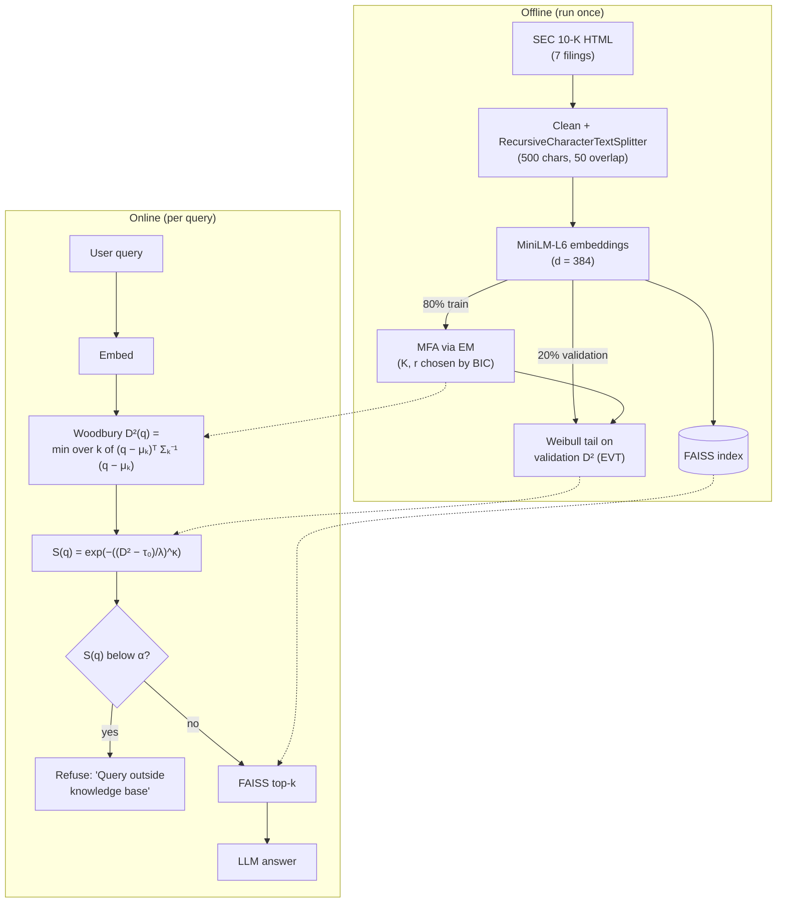
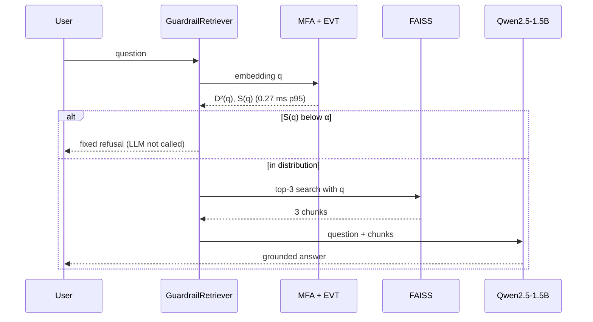
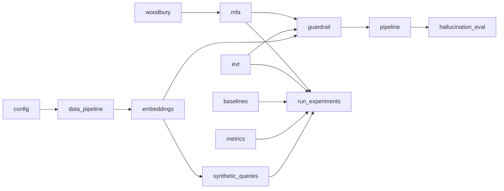

# MFA + EVT Hallucination Guardrail for RAG

A pre-retrieval out-of-distribution (OOD) guardrail for Retrieval-Augmented Generation. The guardrail models the density of in-distribution embeddings with a **Mixture of Factor Analyzers** (custom EM, Woodbury low-rank inversion) and calibrates the rejection threshold with **Extreme Value Theory** (Weibull peaks-over-threshold). Queries with tail p-value S(q) < α are rejected *before* retrieval and LLM generation.

- Proposal: [proposal.md](proposal.md) / [proposal.pdf](proposal.pdf)
- Final report: [report/final_report.pdf](report/final_report.pdf) (source: [report/final_report.md](report/final_report.md))
- Corpus: 7 SEC 10-K filings (AAPL, MSFT, GOOGL, NVDA, AMZN, META, TSLA), 6,368 chunks, MiniLM-L6 (d = 384)
- Test set: 150 ID, 100 Near-OOD (counterfactual, same vocabulary), 100 Far-OOD (general trivia)

## Pipeline



New to the project? Start with **[PROJECT_GUIDE.md](PROJECT_GUIDE.md)**: a full walkthrough of the problem, data, concepts, implementation, results and likely review questions.

## Key results (passage-fit, BIC-selected K = 2, r = 64)

| | AUROC all | AUROC Near-OOD | AUROC Far-OOD | FPR@95 all |
|---|---|---|---|---|
| **MFA + EVT (proposed)** | 0.929 | 0.858 | 1.000 | 0.250 |
| Cosine NN (FAISS) | 0.947 | 0.894 | 1.000 | 0.160 |
| K-Means Euclidean | 0.926 | 0.853 | 0.999 | 0.325 |
| Diagonal GMM | 0.932 | 0.865 | 0.999 | 0.260 |
| Full-cov GMM (extra) | 0.962 | 0.924 | 1.000 | 0.140 |

- **Operating point, α = 0.01 (passage-calibrated EVT):** 100% of ID queries pass, 89% of Far-OOD and 1% of Near-OOD are rejected.
- **Operating point, α = 0.1 (EVT calibrated on ID questions with 3-fold cross-fitting over the ID test set):** 95.3% of ID queries pass, 47% of Near-OOD and 100% of Far-OOD are rejected.
- **Latency:** guardrail scoring takes 0.16 ms p50 / 0.27 ms p95 (target < 10 ms). Naive per-query inversion takes 134 ms.
- **Downstream RAG:** with a plain RAG prompt, the local Qwen2.5-1.5B gives ungrounded answers to 39% of OOD queries. The guardrail lowers this to **7%** (α = 0.01, no ID queries blocked) or **2.5%** (question-calibrated, α = 0.1). With a strict abstention prompt the LLM already refuses 98.5% of OOD queries, and the guardrail mainly saves the LLM call. ID faithfulness (NLI) is unchanged at 0.51.
- **Honest takeaways:** Far-OOD is solved. Near-OOD is hard for every embedding-density method, and the MFA does not beat cosine-NN or full-covariance GMM at this scale. See the report for discussion.

## Guardrail flow for a single query



## Repository layout

```
src/
  config.py             paths and hyperparameters
  data_pipeline.py      EDGAR download, HTML cleaning, chunking        (Week 1)
  embeddings.py         MiniLM embedding of chunks and queries         (Week 1)
  woodbury.py           low-rank-plus-diagonal Gaussian algebra        (Week 2)
  mfa.py                Mixture of Factor Analyzers, EM, BIC           (Week 2)
  evt.py                Weibull tail fitting and p-values              (Week 3)
  baselines.py          cosine/FAISS, K-Means, diag/full GMM, Ledoit-Wolf
  guardrail.py          MFAEVTGuardrail + LangChain FaissRetriever / GuardrailRetriever
  pipeline.py           end-to-end RAG (local Qwen2.5-1.5B-Instruct)
  synthetic_queries.py  doc2query questions (query-fit ablation)
  run_experiments.py    BIC grid, metrics, operating points, plots, latency   (Week 4)
  hallucination_eval.py unguarded vs guarded RAG, NLI faithfulness             (Week 4)
  metrics.py, plotting.py
notebooks/  01_data_pipeline · 02_mfa_training · 03_evt_calibration · 04_benchmarking · demo
results/    metrics CSVs, evt_params.json, latency_report.csv, figures, saved models
report/     final_report.md / .pdf and build_report.py
tests/      unit tests (Woodbury vs dense, EM monotonicity, BIC, EVT)
data/       raw 10-Ks, chunks, embeddings, query sets, synthetic questions
```

## Module dependencies



## Reproduce

```bash
pip install -r requirements.txt
python -m src.data_pipeline        # chunks (downloads 10-Ks if data/raw is empty)
python -m src.embeddings           # corpus + query embeddings
python -m src.synthetic_queries    # optional ablation, ~1.5 h on CPU
python -m src.run_experiments      # ~25 min on CPU
python -m src.hallucination_eval   # ~1.5 h on CPU (local LLM + NLI judge)
python scripts/build_notebooks.py  # build + execute notebooks
python report/build_report.py      # final_report.pdf
python -m pytest -q
```

Try the guardrail on any question:

```bash
python -m src.pipeline "What are the main risk factors for Tesla's vehicle production?"
python -m src.pipeline "Who painted the Mona Lisa?"
```

```python
from src.guardrail import MFAEVTGuardrail
g = MFAEVTGuardrail.load()            # results/models/mfa_selected.npz + evt_selected.json
d = g.check("What was Microsoft's revenue from lunar data centers?")
print(d.label, d.p_value, d.d_sq)
```

## Notes on deviations from the proposal

- **Generator and judge.** GPT-4o-mini and Ragas were replaced by a local Qwen2.5-1.5B-Instruct and an NLI-based (DeBERTa-v3) faithfulness score, because no API key was available. The metric definition is the same: the fraction of answer claims entailed by the retrieved context.
- **Rank grid.** The grid was extended to r = 64 because BIC was still improving at r = 32.
- **Extra baselines and ablations.** Two baselines were added (full-covariance GMM, Ledoit–Wolf), along with a query-fit ablation using doc2query synthetic questions and an ID-question-calibrated EVT ablation.
