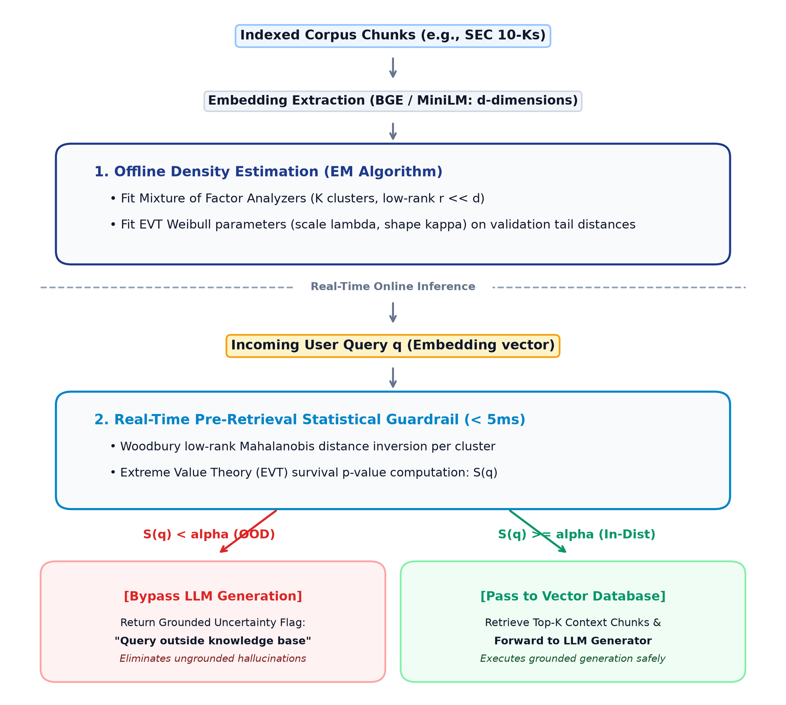
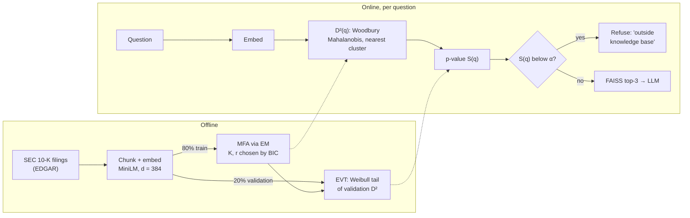
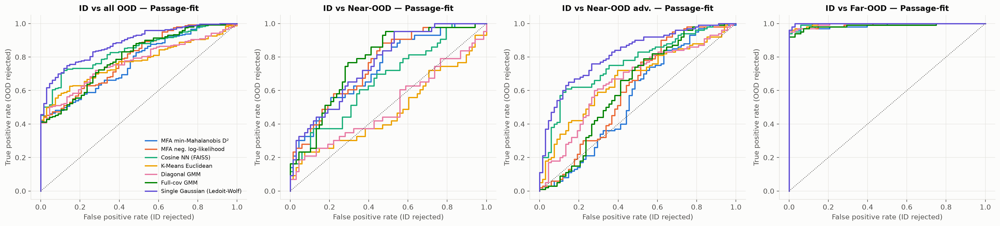
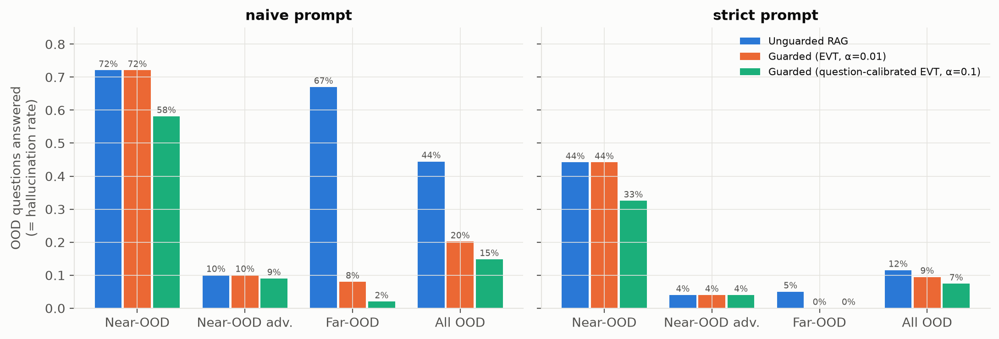

# Hallucination Guardrails via MFA and EVT

**A pre-retrieval statistical guardrail for Retrieval-Augmented Generation (RAG).** Before a question reaches the retriever and the LLM, the guardrail checks whether it lies inside the knowledge base's embedding distribution. It uses a **Mixture of Factor Analyzers (MFA)** density with fast **Woodbury** low-rank algebra, and calibrates the decision threshold with **Extreme Value Theory (EVT)**. Out-of-scope questions are refused, so the LLM never gets the chance to hallucinate an answer to them.

📄 **[Final report](report/report.md)** ([PDF](report/report.pdf)) · 📝 [Proposal](docs/proposal.md) · 📓 [Notebooks](notebooks/)

---

## The problem

A RAG system always retrieves the *closest* chunks, even when the knowledge base cannot answer the question. Given irrelevant context, the LLM often answers anyway, which produces **hallucinations**: fluent answers that the knowledge base does not support.

| Question | Kind | What should happen |
|---|---|---|
| *"What is the FY2018 capital expenditure amount for 3M?"* | **In-distribution (ID)**: answerable from the indexed filings | answer it |
| *"What drove operating margin change as of FY22 for AMD?"* | **Near-OOD**: same domain, but AMD's filings are not indexed | refuse |
| *"What was Apple's net revenue from the Apple Car project in 2024?"* | **Near-OOD (adversarial)**: indexed company, but the fact does not exist | refuse |
| *"Which Mario game first introduced Wario?"* | **Far-OOD**: unrelated topic | refuse |

**Goal:** reject out-of-distribution questions *before* retrieval, cheaply (target < 10 ms), with a statistically calibrated false-rejection rate.

## Approach

The architecture from the [proposal](docs/proposal.md):

<p align="center"></p>

As implemented:



- **MFA:** each topic cluster is modelled as a Gaussian with covariance `WWᵀ + Ψ` (r main directions plus per-dimension noise), trained from scratch with EM. → [src/mfa.py](src/mfa.py), [notebook 02](notebooks/02_mfa_training.ipynb)
- **Woodbury:** inverts `WWᵀ + Ψ` through an r × r matrix, so scoring a question costs O(d·r) instead of O(d³). → [src/woodbury.py](src/woodbury.py)
- **EVT:** a Weibull model of the extreme tail of validation distances turns a distance into a p-value S(q). → [src/evt.py](src/evt.py), [notebook 03](notebooks/03_evt_calibration.ipynb)

## Data

| Set | Size | Source |
|---|---|---|
| Knowledge base | 52,943 chunks from 50 SEC 10-K filings (43 FinanceBench filings + 7 recent big-tech 10-Ks) | [SEC EDGAR](https://www.sec.gov/edgar/search/) |
| ID questions | 68 analyst-written questions on indexed companies (answer evidence verified in our text) | [FinanceBench](https://huggingface.co/datasets/PatronusAI/financebench) ([paper](https://arxiv.org/abs/2311.11944)) |
| Near-OOD | 43 FinanceBench questions on 9 held-out companies | FinanceBench |
| Near-OOD (adversarial) | 100 counterfactual questions (entity perturbation), a stress test | constructed for this project |
| Far-OOD | 100 general-knowledge trivia questions | [Open Trivia DB](https://opentdb.com/) |

The full data description, including how the split was made and the checks performed, is in [report §2](report/report.md#2-data).

## Key results

Selected model: **MFA with K = 16 clusters, rank r = 64** (373k parameters, 69% fewer than a full-covariance GMM). EVT tail: τ₀ = 483, κ = 1.05, λ = 50.9 (bootstrap KS p = 0.16).

**Detection (AUROC, higher is better):**

| Method | Near-OOD (real) | Near-OOD adversarial | Far-OOD |
|---|---|---|---|
| **MFA + EVT (proposed)** | **0.736** | 0.559 | 0.988 |
| MFA log-likelihood | **0.756** | 0.608 | 0.991 |
| Cosine similarity (FAISS) | 0.662 | 0.762 | 0.996 |
| K-Means / diagonal GMM | 0.481 / 0.507 | 0.669 / 0.656 | 0.996 / 0.994 |
| Full-cov GMM / Ledoit–Wolf | 0.772 / 0.760 | 0.619 / 0.819 | 0.986 / 0.999 |

<p align="center"></p>

**End-to-end hallucination rate on OOD questions** (naive RAG prompt):

| | Unguarded | Guarded α = 0.01 | Guarded α = 0.1 (question-calibrated) |
|---|---|---|---|
| All OOD | 44.4% | **20.2%** | **14.8%** |
| Far-OOD | 67% | 8% | 2% |
| Near-OOD | 72% | 72% | 58% |
| ID questions blocked | 0% | **0%** | 7.4% |

<p align="center"></p>

**Takeaways**
- **Far-OOD is solved:** AUROC ≥ 0.99, and the guardrail removes almost all trivia hallucinations.
- **On real Near-OOD questions** (companies outside the knowledge base), covariance-aware densities (MFA, full GMM) beat cosine similarity, K-Means and the diagonal GMM.
- **False-premise questions about indexed companies** (the adversarial set) look in-distribution, so density gates cannot catch them and a post-retrieval check is needed.
- **Fast:** 0.77 ms per question (p50), 1.45 ms at p95, about 2,000× faster than naive covariance inversion.

## Repository structure

```
├── README.md
├── report/            final report (report.md, report.pdf)
├── docs/              proposal and its figure
├── src/               library code
│   ├── data_pipeline.py      HTML cleaning and chunking (500 chars, 50 overlap)
│   ├── embeddings.py         MiniLM embeddings
│   ├── woodbury.py           low-rank-plus-diagonal Gaussian algebra
│   ├── mfa.py                Mixture of Factor Analyzers: EM, BIC
│   ├── evt.py                Weibull peaks-over-threshold calibration
│   ├── guardrail.py          MFAEVTGuardrail + LangChain retrievers
│   ├── baselines.py          cosine, K-Means, diagonal/full GMM, Ledoit-Wolf
│   ├── metrics.py            AUROC, AUPR, FPR@95%TPR
│   ├── run_experiments.py    benchmark: BIC grid, EVT, baselines, plots, latency
│   ├── pipeline.py           end-to-end RAG (Qwen2.5-1.5B-Instruct)
│   └── hallucination_eval.py unguarded vs guarded RAG, NLI faithfulness
├── scripts/           dataset building and notebook generation
├── notebooks/         01 data · 02 MFA · 03 EVT · 04 benchmark · demo
├── data/              chunks, embeddings, test questions, FinanceBench metadata
├── results/           metrics (CSV/JSON), figures, trained models
└── tests/             unit tests (Woodbury vs dense, EM monotonicity, BIC, EVT)
```

## Reproduce

```bash
pip install -r requirements.txt
python scripts/fetch_financebench_filings.py   # download the FinanceBench 10-Ks from EDGAR
python scripts/build_financebench_dataset.py   # knowledge base + test questions
python -m src.embeddings                       # MiniLM embeddings
python -m src.run_experiments                  # MFA, EVT, baselines, figures (~1.5 h on CPU)
python -m src.hallucination_eval               # RAG answers + NLI (GPU recommended)
python scripts/build_notebooks.py              # execute the notebooks
python -m pytest -q
```

Try the guardrail:

```python
from src.guardrail import MFAEVTGuardrail
g = MFAEVTGuardrail.load()
print(g.check("Who painted the Mona Lisa?"))       # → OOD, refused before retrieval
```

The earlier pilot version (7 big-tech filings, generated ID questions) is kept on the [`old` branch](https://github.com/GellaNagaSaiKrishna/Hallucination-Guardrails-via-MFA-and-EVT/tree/old).
