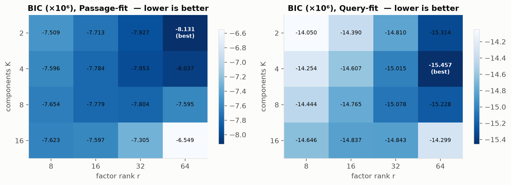
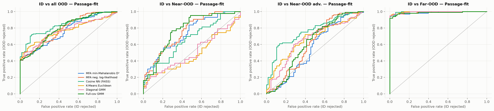
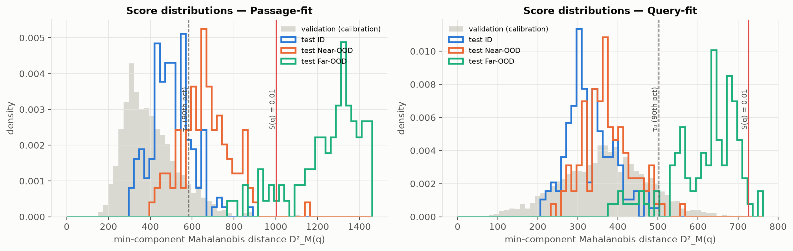
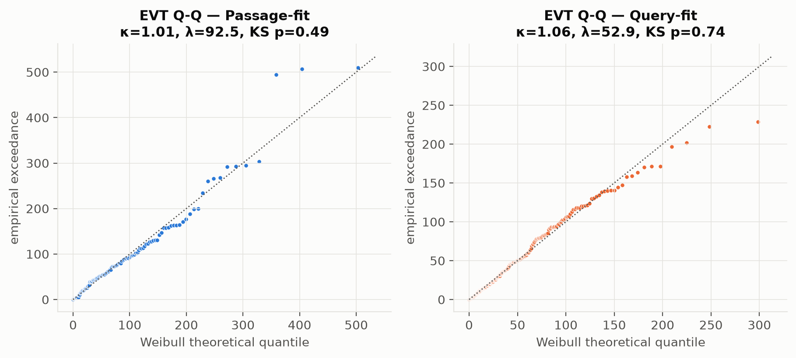

# Latent Manifold Density Estimation via Mixture of Factor Analyzers for OOD Hallucination Guardrails in RAG

> Final report · Gella Naga Sai Krishna · Data Science (Semester 5) · November 2026 · Code: github.com/GellaNagaSaiKrishna/mfa-evt-rag-guardrail

## 1. Introduction & Motivation

Retrieval-Augmented Generation (RAG) systems retrieve the nearest chunks for *every* query, including queries the knowledge base cannot answer. If the language model then receives irrelevant context, it can produce fluent but ungrounded answers. This project builds and evaluates a **pre-retrieval statistical guardrail**. The guardrail models the density of in-distribution (ID) embeddings with a **Mixture of Factor Analyzers (MFA)**, scores queries with a **Woodbury low-rank Mahalanobis distance**, and turns that distance into a p-value with an **Extreme Value Theory (EVT)** Weibull tail. Queries with S(q) < α are rejected before retrieval and generation.

The work follows the four-week plan of the proposal: data pipeline and baselines, a from-scratch MFA/EM implementation, EVT calibration with a LangChain guardrail retriever, and benchmarking (AUROC, FPR@95%TPR, faithfulness/hallucination, latency). Along the way, the experiments produced findings that partly *contradict* the proposal's hypotheses, and these are reported as found (Sections 4–5).

**Summary of findings**

- On this benchmark, the MFA guardrail separates **Far-OOD almost perfectly** (AUROC 0.9997, 0% FPR@95). **Near-OOD** is much harder (AUROC 0.858), and here the MFA is *not* better than simpler baselines: the cosine nearest-neighbour score reaches 0.894, and a full-covariance GMM reaches 0.924.
- The Weibull tail model is adequate but not a tight fit: a KS test that accounts for the fitted parameters (parametric bootstrap) gives p = 0.08, so the fit is not rejected at the 5% level. However, when it is calibrated on *passages*, the α = 0.01 rule is very conservative for *questions*: 100% ID pass, 89% Far-OOD rejected, 1% Near-OOD rejected. When the same EVT is calibrated on ID *questions* (3-fold cross-fitting over the ID test questions, so each query is scored by a tail it was not fitted on), the target false-rejection rate holds (95.3% ID pass at a 5% nominal level) while rejecting 47% of Near-OOD and 100% of Far-OOD queries.
- Woodbury scoring costs **0.16 ms (p50) / 0.27 ms (p95)** per query, far below the 10 ms target. Embedding the query (≈33 ms) dominates the guardrail's overhead.
- Downstream (Section 4.4): with a plain RAG prompt, the local LLM gives ungrounded answers to 39% of OOD queries. The guardrail lowers this to 7% (α = 0.01) or 2.5% (question-calibrated, α = 0.1), with no ID cost at α = 0.01. With a strict abstention prompt, the LLM already refuses 98.5% of OOD queries, so the guardrail mainly saves the LLM call.

## 2. Mathematical Framework

### 2.1 Mixture of Factor Analyzers

Each component explains a d-dimensional embedding through an r-dimensional latent factor (r ≪ d):

```
y ~ N(0, I_r),   x | y, z=k ~ N(mu_k + W_k y, Psi_k)
p(x) = sum_k pi_k N(x | mu_k, W_k W_k^T + Psi_k),    Psi_k diagonal
```

Each component then has d·r + 2d − r(r−1)/2 free parameters instead of d(d+3)/2. For the selected model (d = 384, K = 2, r = 64), that is **46,657 parameters versus 148,609 for a full-covariance GMM**, a 69% reduction that still captures the 64 dominant correlated directions per component.

### 2.2 Expectation–Maximization (implemented from scratch in `src/mfa.py`)

E-step (with log-sum-exp normalisation):

```
gamma_ik   = pi_k N(x_i|k) / sum_j pi_j N(x_i|j)
beta_k     = (I_r + W_k^T Psi_k^-1 W_k)^-1 W_k^T Psi_k^-1
E[y|x,k]   = beta_k (x - mu_k)
E[yy^T|x,k]= I_r - beta_k W_k + E[y] E[y]^T
```

M-step (AECM ordering: π and μ first, then the factor-analysis update about the new mean):

```
pi_k = N_k/N,   mu_k = sum_i gamma_ik x_i / N_k
W_k  = [sum_i gamma_ik (x_i-mu_k) E[y_i]^T] [sum_i gamma_ik E[y_i y_i^T]]^-1
Psi_k = diag(S_k - W_k beta_k S_k),   Psi_k >= 1e-4 * Var(X)
```

All sufficient statistics are formed as N×r products, so no d×d matrix is ever built. Initialisation uses K-Means (10 restarts) followed by a per-cluster PPCA solution (top-r singular vectors). Convergence is declared when the relative change in log-likelihood is below 1e-5 (maximum 50 iterations). Unit tests (`tests/test_core.py`) verify that the log-likelihood never decreases, that the component weights are recovered on synthetic data, and that BIC recovers the true K.

### 2.3 Woodbury low-rank inversion

```
Sigma^-1 = Psi^-1 - Psi^-1 W (I_r + W^T Psi^-1 W)^-1 W^T Psi^-1
log|Sigma| = sum_j log psi_j + 2 sum_i log L_ii,   L = chol(I_r + W^T Psi^-1 W)
D_M^2(q) = min_k (q - mu_k)^T Sigma_k^-1 (q - mu_k)
```

Each component costs O(d r²+r³) once, and each query costs O(d r). The implementation matches dense inversion to within 1e-13, as checked by the unit tests.

### 2.4 Extreme Value Theory calibration

Following the peaks-over-threshold approach (Pickands–Balkema–de Haan), the threshold τ₀ is set to the 90th percentile of D²_M over a held-out validation split. A Weibull distribution F(e) = 1 − exp(−(e/λ)^κ) is then fitted by maximum likelihood to the exceedances e = D² − τ₀ (`scipy.stats.weibull_min.fit(E, floc=0)`). A query's tail p-value is

```
S(q) = exp( -( max(0, D_M^2(q) - tau_0) / lambda )^kappa ),   reject if S(q) < alpha (= 0.01)
```

S(q) is the survival probability *conditional on exceeding τ₀*, as in the proposal. Because S is a monotone function of D², EVT does not change any threshold-free metric (AUROC/AUPR). Its job is to set a principled operating point that extrapolates beyond the empirical validation quantiles.

## 3. Dataset & Experimental Setup

**Corpus.** The corpus consists of seven SEC 10-K filings (Apple FY2025, Microsoft FY2026, Alphabet FY2025, NVIDIA FY2026, Amazon FY2025, Meta FY2025, Tesla FY2025) downloaded from EDGAR. The original pipeline used regex HTML stripping plus very aggressive filters and kept only 2,534 chunks. It was rewritten (`src/data_pipeline.py`) to parse the inline-XBRL HTML with BeautifulSoup, drop the hidden XBRL header, render tables row by row, remove page numbers and running headers, and split with LangChain `RecursiveCharacterTextSplitter(chunk_size=500, chunk_overlap=50)`. Chunks shorter than 100 characters or containing fewer than 8 words were dropped, along with exact duplicates. The result is **6,368 chunks** (mean 360 characters), split 80/20 into train (5,095) and validation (1,273).

**Embeddings.** `all-MiniLM-L6-v2` (d = 384), L2-normalised, indexed with FAISS `IndexFlatIP` (cosine similarity).

**Test queries (350).** These comprise 150 ID questions answerable from the filings; 100 Near-OOD questions that use the same companies and vocabulary but ask about counterfactual events (e.g. *"How much goodwill did Amazon recognize upon completing the acquisition of Target Corporation in 2024?"*); and 100 Far-OOD general-knowledge trivia questions. The Far-OOD questions come from an Open Trivia DB-style source (video games, film, history, science) rather than from HotpotQA/TriviaQA as the proposal planned. They play the same role.

**Methods compared.** All methods are fitted on the same training split, with K set to the BIC-selected K* = 2:

| Method | OOD score (higher = more OOD) |
|---|---|
| **MFA + EVT (proposed)** | min-component Woodbury Mahalanobis D²; decision S(q) < α |
| MFA negative log-likelihood | −log p(q) under the MFA (ablation) |
| Baseline 1: Cosine NN (FAISS) | 1 − max cosine similarity to any chunk |
| Baseline 2: K-Means Euclidean | distance to nearest of K* centroids |
| Baseline 3: Diagonal GMM | negative log-likelihood (sklearn, K* components) |
| Extra: Full-covariance GMM | negative log-likelihood (sklearn, `reg_covar = 1e-6`) |
| Extra: Single Gaussian (Ledoit–Wolf) | Mahalanobis distance with shrinkage covariance |

**Ablation: fitting source.** Search queries and passages embed differently (query–passage asymmetry). To test whether this matters, **12,668 synthetic questions** were generated with `doc2query/msmarco-t5-base-v1` (2 per chunk; 68 chunks kept only 1 after removing duplicates). Every method was also fitted on the 10,135 questions from training chunks, and the 2,533 questions from validation chunks were used for calibration, so the test queries were never seen. This is called *query-fit*; the proposal's setting is *passage-fit*.

**Metrics.** AUROC, AUPR, and FPR@95%TPR are reported with OOD as the positive class. FPR@95%TPR uses the threshold that retains 95% of ID queries and reports the fraction of OOD queries still accepted. Operating points report the ID pass rate and the Near/Far-OOD rejection rates. Latency is measured over 1,000 single-query calls with `time.perf_counter`.

## 4. Results

### 4.1 Model selection (BIC)



The proposal's grid was r ∈ {8, 16, 32}. Since BIC was still decreasing at r = 32, the grid was extended to r = 64. For passages, BIC selects **K* = 2, r* = 64** (EM converged in 20 iterations, 5.9 s). For synthetic questions it selects K = 4, r = 64 (converged in 45 iterations). Note that 8 of the 16 query-fit grid points, mostly the large-K or large-r ones, reached the 50-iteration cap before meeting the 1e-5 tolerance, so their BIC values are slightly pessimistic. This does not affect the passage-fit selection, where all fits converged. Large K is strongly penalised: with only ~5k training points, K = 16 and r = 64 would need 373k parameters. Because the optimum lies on the edge of the grid (r = 64), the true optimum may have an even higher rank. EM increased the log-likelihood monotonically in both selected fits (`results/em_loglik.png`), and the unit tests check this property on synthetic data.

### 4.2 OOD detection performance

**Table 1. Passage-fit (the proposal's setting).** 150 ID vs 100 Near-OOD / 100 Far-OOD test queries.

| Method | AUROC (all) | AUROC Near | AUROC Far | FPR@95 (all) ↓ | FPR@95 Near ↓ | AUPR-OOD |
|---|---|---|---|---|---|---|
| **MFA + EVT (proposed)** (ranks by D²) | 0.929 | 0.858 | 1.000 | 0.250 | 0.50 | 0.954 |
| MFA neg. log-likelihood | 0.932 | 0.864 | 1.000 | 0.230 | 0.46 | 0.956 |
| Cosine NN (FAISS) | 0.947 | 0.894 | 1.000 | 0.160 | 0.32 | 0.966 |
| K-Means Euclidean | 0.926 | 0.853 | 0.999 | 0.325 | 0.64 | 0.950 |
| Diagonal GMM | 0.932 | 0.865 | 0.999 | 0.260 | 0.51 | 0.954 |
| Full-cov GMM | **0.962** | **0.924** | 1.000 | **0.140** | **0.28** | **0.975** |
| Single Gaussian (Ledoit–Wolf) | 0.960 | 0.920 | 1.000 | 0.180 | 0.36 | 0.972 |



**Table 2. Query-fit ablation** (fitted and calibrated on doc2query questions).

| Method | AUROC (all) | AUROC Near | AUROC Far | FPR@95 Near ↓ |
|---|---|---|---|---|
| MFA min-Mahalanobis D² | 0.845 | 0.699 | 0.992 | 0.85 |
| MFA neg. log-likelihood | 0.898 | 0.799 | 0.997 | 0.70 |
| Cosine NN | 0.915 | 0.839 | 0.991 | 0.52 |
| Full-cov GMM | 0.917 | 0.838 | 0.996 | 0.76 |
| Single Gaussian (Ledoit–Wolf) | 0.949 | 0.899 | 0.999 | 0.38 |

What the tables show:

1. **Far-OOD is solved by every density method.** All passage-fit scorers reach an AUROC of at least 0.999, and the MFA achieves 0.000 FPR@95 on Far-OOD.
2. **Near-OOD is the real challenge.** The near-OOD queries reuse company names and financial vocabulary, so in MiniLM space they lie close to the corpus. Here the MFA (0.858) is roughly tied with the diagonal GMM and K-Means, and is beaten by the non-parametric cosine NN score (0.894) and by the two full-covariance models (0.92). The proposal's assumption that a full-covariance GMM is infeasible does not hold at this scale: with N_k ≫ d and a small ridge (`reg_covar`), sklearn fits it in seconds, and it ranks best. The MFA's advantage, a compact low-rank covariance that is stable at large d, matters most when N_k is comparable to or smaller than d. That regime is not reached with 6k chunks and d = 384.
3. **Ranking by likelihood beats ranking by distance.** The MFA negative log-likelihood (which includes the log-determinant and mixture weights) is better than min-D² in both settings, by a large margin under query-fit (0.799 vs 0.699 on Near-OOD).
4. **Query-fit hurts.** doc2query produces short, generic MS-MARCO-style questions ("what are accelerated filers"). Their density is broad and covers trivia-style questions, so every method gets worse. The query–passage shift is real (see the score distributions below and the PCA plot in `notebooks/01_data_pipeline.ipynb`), but generic synthetic questions are the wrong fix. A domain-specific question generator would be needed.



### 4.3 Ablation: MFA only vs MFA + EVT (operating points)

EVT matters only at the decision threshold. Table 3 compares the proposed rule with each baseline thresholded at its empirical 99th validation percentile (the same 1% false-alarm budget).

**Table 3. Operating points (passage-fit).**

| Rule | ID pass ↑ | Near-OOD rejected ↑ | Far-OOD rejected ↑ |
|---|---|---|---|
| **MFA + EVT, S(q) < 0.01 (proposal)** | 1.000 | 0.01 | 0.89 |
| MFA + EVT, S(q) < 0.1 | 0.993 | 0.16 | 0.99 |
| MFA + EVT, S(q) < 0.5 | 0.920 | 0.57 | 1.00 |
| **MFA + EVT, question-calibrated, S(q) < 0.1** (3-fold CV) | 0.953 | 0.47 | 1.00 |
| MFA D², val 99th pct | 0.993 | 0.18 | 1.00 |
| Cosine NN, val 99th pct | 0.933 | 0.70 | 1.00 |
| Full-cov GMM, val 99th pct | 0.987 | 0.36 | 1.00 |
| Ledoit–Wolf, val 99th pct | 0.987 | 0.29 | 1.00 |
| K-Means, val 99th pct | 0.993 | 0.05 | 0.95 |
| Diagonal GMM, val 99th pct | 0.993 | 0.07 | 0.94 |



- **The Weibull model is adequate, though not a tight fit.** The shape parameter κ ≈ 1 indicates an approximately exponential tail; a Generalized Pareto fit agrees (shape ξ = 0.02 ≈ 0). The plain KS test gives p = 0.49, but it is optimistic because κ and λ are estimated from the same 128 exceedances. A parametric-bootstrap KS test (2,000 refits, `WeibullTail.bootstrap_ks_pvalue`) gives **p = 0.08**, so the fit is not rejected at the 5% level, but only marginally. The fitted α = 0.01 threshold is D* = 1003. It depends moderately on the choice of τ₀: using the 85th or 95th percentile instead of the 90th gives D* = 944 or 1,086.
- **Calibrating on passages is too conservative for questions.** ID questions have larger D² than ID passages: the median is 498 for test ID questions and 379 for validation passages. Near-OOD questions have a median of 661, and Far-OOD questions a median of 1,314. The passage-calibrated D* = 1,003 therefore sits above every ID question (100% pass) and below most Far-OOD questions (89% rejected), but above almost all Near-OOD questions. Even the much weaker 99th-percentile thresholds pass Near-OOD for most methods. Only cosine NN rejects a majority (70%), at the cost of 6.7% ID false rejections.
- **Calibrating on questions restores the nominal rate.** No separate set of real ID questions was available, so this ablation uses the 150 ID test questions with 3-fold cross-fitting. Each query is scored by a Weibull tail fitted on the 100 ID questions of the other two folds (τ₀ = median, 50 exceedances), so no query is scored by a tail it helped fit. Because the calibration questions come from the same curated set as the test questions, this is an optimistic estimate of what a separate calibration log would give. Under this setup, the realised ID pass rates track the nominal levels: 0.953 at α = 0.1 (nominal 0.95) and 0.740 at α = 0.5 (nominal 0.75). At the α = 0.1 operating point the guardrail rejects 47% of Near-OOD and 100% of Far-OOD queries. In practice the guardrail therefore needs a small set of real ID questions, roughly 100, for calibration.

### 4.4 Downstream hallucination reduction

The guardrail was evaluated end to end. Each test query goes through FAISS top-3 retrieval and a local Qwen2.5-1.5B-Instruct generator (greedy decoding). In the guarded conditions, queries with S(q) < α receive the fixed refusal and never reach the LLM. All other queries receive exactly the same answer as in the unguarded condition, so every difference comes from the gate.

Two system prompts were tested:

- **Strict:** answer only from the context, otherwise reply "I don't have information about this." All 350 queries were run with this prompt.
- **Naive:** "use the provided context to answer", with no abstention instruction. This is the common default RAG template, and the setting a pre-retrieval guardrail is meant to protect. It was run on the 200 OOD queries.

The metrics are defined as follows:

- **Faithfulness (Ragas-style, judged by NLI):** the fraction of answer sentences entailed by a retrieved chunk.
- **Hallucination rate (OOD):** the fraction of OOD queries that receive a substantive, non-refusing answer. The knowledge base cannot support any such answer.
- **Unsupported answers:** substantive answers that NLI also judges unsupported (faithfulness < 0.5).

**Table 4. Downstream RAG evaluation** (150 ID, 100 Near-OOD, 100 Far-OOD queries).

| Prompt | Metric | Unguarded RAG | Guarded, EVT α = 0.01 | Guarded, question-calibrated EVT α = 0.1 |
|---|---|---|---|---|
| strict | Faithfulness, ID (answered) | 0.508 | 0.508 | 0.509 |
| strict | ID answer rate | 0.900 | 0.900 | 0.853 |
| strict | ID queries wrongly blocked | 0.000 | 0.000 | 0.047 |
| strict | Hallucination rate, all OOD | 0.015 | 0.010 | 0.010 |
| strict | Hallucination rate, Near / Far | 0.02 / 0.01 | 0.02 / 0.00 | 0.02 / 0.00 |
| both | OOD queries blocked by guardrail | 0.000 | 0.450 | 0.735 |
| **naive** | **Hallucination rate, all OOD** | **0.390** | **0.070** | **0.025** |
| naive | Hallucination rate, Near-OOD | 0.080 | 0.080 | 0.050 |
| naive | Hallucination rate, Far-OOD | 0.700 | 0.060 | 0.000 |
| naive | Unsupported answers (NLI), all OOD | 0.350 | 0.065 | 0.020 |

- **Under the naive prompt the guardrail is decisive.** Without a gate, the LLM answered 70% of Far-OOD trivia questions from its parametric memory. Some of these answers are correct (*"The longest bone in the human body is the femur"*) and some are invented (*"The main antagonist in Call of Duty: Black Ops II is Kratos, played by Sylvester Stallone"*), but none is grounded in the 10-K knowledge base. The proposed guardrail (α = 0.01) removes 91% of these ungrounded answers, and the question-calibrated variant removes all of them, lowering the overall OOD hallucination rate from 39% to 7% and 2.5% respectively.
- **Near-OOD hallucinations are fewer but more dangerous.** With the naive prompt, the LLM produced 8 confident fabrications for counterfactual financial questions, for example *"Amazon recognized $3.88 billion in goodwill upon completing the acquisition of Target Corporation in 2024"* and *"The gross margin on Meta Quest Pro headsets manufactured in Vancouver in fiscal 2024 was $180,683 million."* These answers sound plausible to a user. The passage-calibrated gate (α = 0.01) misses all of them, consistent with its 1% Near-OOD rejection rate (Table 3). The question-calibrated gate catches 3 of the 8 (8% → 5%).
- **A strict prompt is a strong complementary defence.** With the abstention instruction, the 1.5B model already refuses 98.5% of OOD queries, so the guardrail can only reduce hallucinations from 1.5% to 1.0%. Its value in this regime is cost and latency: 45–74% of OOD queries never reach the LLM, which saves about 15 s of CPU generation per blocked query. It also gives a deterministic refusal that does not depend on how well the generator follows instructions.
- **Cost on ID queries.** At α = 0.01 the guardrail never blocks an ID query, so ID faithfulness and answer rate are unchanged. The question-calibrated gate blocks 4.7% of ID queries (nominal 5%) and leaves the faithfulness of the remaining answers unchanged. The absolute ID faithfulness (0.51) reflects both the small generator and the strictness of sentence-level NLI on paraphrases and numbers. The guardrail does not change it, because it acts only before retrieval.
- **Measurement caveat.** Abstention is detected with a regular expression over refusal phrases. All 200 naive OOD answers were inspected manually when tuning it. A handful of borderline answers that reject the premise (*"NVIDIA does not manufacture silicon wafers ..."*) are still counted as substantive, so the naive Near-OOD rate is slightly pessimistic.

### 4.5 Latency

**Table 5. Per-query latency, 1,000 queries, CPU (Intel, 14 threads), K = 2, r = 64, d = 384.**

| Component | mean (ms) | p50 | p95 | p99 |
|---|---|---|---|---|
| **Woodbury MFA scoring (guardrail)** | 0.174 | 0.159 | **0.273** | 0.420 |
| Dense pre-computed precision matrices | 0.101 | 0.099 | 0.128 | 0.270 |
| Naive: build and invert Σ_k for every query | 126.9 | 133.6 | 170.0 | 177.5 |
| Query embedding (MiniLM, for reference) | 34.5 | 33.2 | 59.8 | 80.6 |

The P95 latency is **0.27 ms, about 37× below the 10 ms target**, and roughly 600× faster than inverting the covariance on every query. Note that at d = 384 and K = 2, pre-computing dense d×d precision matrices once is equally fast per query. Woodbury's practical advantages are memory (K·d·r = 49k numbers instead of K·d² = 295k) and numerically stable training: EM never forms or inverts a d×d matrix. These advantages grow with d (e.g. 768-d BGE) and K. The guardrail adds less than 1% to the cost of embedding the query, which a RAG system pays anyway.

## 5. Discussion, Limitations & Future Work

- **The near-OOD benchmark is close to adversarial for density methods.** The near-OOD questions are lexically almost identical to ID questions, and a sentence embedding largely encodes topic, not whether a specific fact exists. No embedding-density method can reliably decide whether *"Microsoft's quantum chip revenue in 2018"* is answerable. Retrieval-level signals (cosine NN is the strongest single baseline here) or post-retrieval checks (answerability classifiers, NLI between question and retrieved chunks) are complementary and should be combined with the density gate.
- **The MFA's benefit depends on scale.** With 6k chunks and d = 384, a full-covariance GMM is feasible and slightly better. The MFA's advantages (fewer parameters, no d×d algebra) should matter for larger embeddings (768–1024-d), more components, or smaller clusters. Testing BGE-base embeddings and a larger corpus is the natural next step.
- **Calibration data must match deployment queries.** The EVT is only as good as its calibration distribution. Passage calibration is valid but conservative; question calibration achieves the nominal rate. Logging real user questions, or generating domain-specific ones with an instruction-tuned LLM rather than MS-MARCO doc2query, would remove the need for hand-labelled calibration questions.
- **Evaluation substitutions.** No API key was available, so GPT-4o-mini was replaced by a local Qwen2.5-1.5B-Instruct, and Ragas (which needs an LLM judge) was replaced by an NLI-based faithfulness score with the same claim-support definition. NLI is strict on paraphrases, so absolute faithfulness values are pessimistic; only the comparison between conditions is meaningful. The query sets were curated before this work. Far-OOD comes from an Open Trivia DB-style source, and some Far-OOD questions mention technology companies (e.g. Google Drive's launch date).
- **Score choice.** Ranking by the MFA's full log-likelihood was consistently better than min-D². A natural extension is to apply EVT to −log p(q) or to a responsibility-weighted distance.

## 6. Conclusion

A complete pre-retrieval guardrail was implemented, tested and benchmarked: a corpus pipeline, a from-scratch MFA trained by EM with Woodbury algebra, BIC model selection, EVT tail calibration, a LangChain `GuardrailRetriever`, and an end-to-end RAG evaluation. The guardrail is fast (0.27 ms p95), statistically well calibrated when the calibration data matches the queries (95.3% ID pass at a 95% target), and removes Far-OOD queries completely. On semantically near OOD queries, the MFA density did not outperform simpler cosine or full-covariance baselines at this scale, and passage-calibrated EVT at α = 0.01 is too permissive for them. These negative results define clear next steps: score by likelihood, calibrate on real questions, scale to higher-dimensional embeddings, and pair the density gate with a retrieval-level answerability check.

## Appendix: Reproducing

```
pip install -r requirements.txt
python -m src.data_pipeline          # 10-K download + chunking  -> data/chunk_texts.json
python -m src.embeddings             # MiniLM embeddings          -> data/*.npy
python -m src.synthetic_queries      # doc2query questions (ablation, ~1.5 h CPU)
python -m src.run_experiments        # BIC, EVT, baselines, metrics, plots, latency (~25 min)
python -m src.hallucination_eval     # RAG generation + NLI evaluation (~1.5 h CPU)
python scripts/build_notebooks.py    # executes notebooks/
python report/build_report.py        # this PDF
python -m pytest -q                  # unit tests
```
