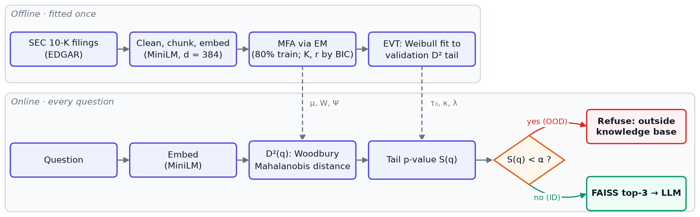
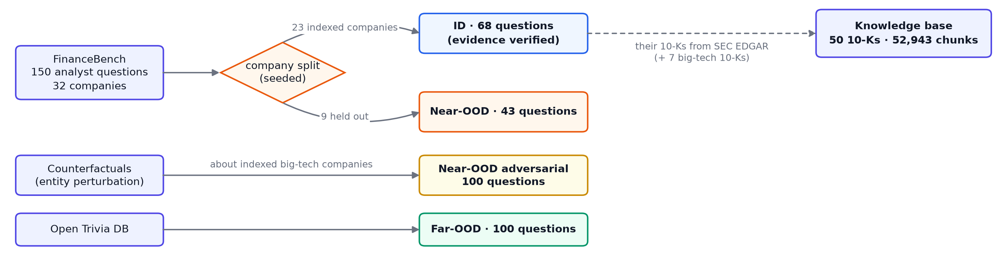
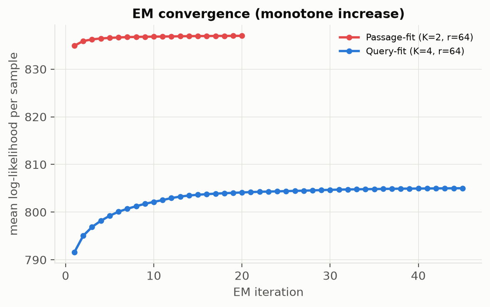

# Hallucination Guardrails via MFA and EVT

> Gella Naga Sai Krishna · Data Science, Semester 5 · November 2026 · Code: [github.com/GellaNagaSaiKrishna/Hallucination-Guardrails-via-MFA-and-EVT](https://github.com/GellaNagaSaiKrishna/Hallucination-Guardrails-via-MFA-and-EVT)

## 1. Problem and approach

A Retrieval-Augmented Generation (RAG) system retrieves the closest chunks of a knowledge base and asks an LLM to answer from them. Nearest-neighbour retrieval always returns *something*, even when the knowledge base cannot answer the question, and the LLM then often produces a fluent but unsupported answer (a hallucination). This project builds a **pre-retrieval guardrail**: a statistical test on the question's embedding that refuses out-of-distribution (OOD) questions before retrieval and generation. The test combines a **Mixture of Factor Analyzers (MFA)** density, a fast **Woodbury** Mahalanobis distance and an **Extreme Value Theory (EVT)** p-value.

<p align="center"></p>

*Figure 1. Offline, the MFA is fitted on training chunks and the EVT tail on validation distances. Online, a question's distance is turned into a p-value S(q) and the question is refused if S(q) < α.*

## 2. Data

<p align="center"></p>

*Figure 2. How the knowledge base and the four question sets were built.*

| Set | Size | Source |
|---|---|---|
| Knowledge base | 50 10-K filings → 52,943 chunks | [SEC EDGAR](https://www.sec.gov/edgar/search/): the FinanceBench filings of 23 companies + the latest 10-Ks of 7 big-tech companies |
| ID | 68 | [FinanceBench](https://huggingface.co/datasets/PatronusAI/financebench) ([Islam et al., 2023](https://arxiv.org/abs/2311.11944)), questions whose evidence passage is found in our text (median coverage 97%) |
| Near-OOD | 43 | FinanceBench questions on 9 held-out companies (AMD, Adobe, Block, Boeing, General Mills, MGM, Netflix, PayPal, Verizon) |
| Near-OOD adversarial | 100 | constructed counterfactuals about indexed companies (e.g. *Apple Car revenue*), a false-premise stress test |
| Far-OOD | 100 | [Open Trivia Database](https://opentdb.com/) |

Filings are parsed with BeautifulSoup (inline-XBRL header, page numbers and repeated headers removed), split into 500-character chunks with 50 overlap, embedded with [all-MiniLM-L6-v2](https://huggingface.co/sentence-transformers/all-MiniLM-L6-v2) (d = 384) and split at random into **42,355 training** and **10,588 validation** chunks. Test questions are never used for fitting. Walkthrough: [notebook 01](https://github.com/GellaNagaSaiKrishna/Hallucination-Guardrails-via-MFA-and-EVT/blob/main/notebooks/01_data_pipeline.ipynb).

## 3. Method

### 3.1 Mixture of Factor Analyzers · [notebook 02](https://github.com/GellaNagaSaiKrishna/Hallucination-Guardrails-via-MFA-and-EVT/blob/main/notebooks/02_mfa_training.ipynb)

Each of K clusters explains an embedding by r ≪ d latent factors plus independent noise, giving a low-rank-plus-diagonal covariance:

```
p(x) = Σ_k π_k N(x | μ_k, W_k W_kᵀ + Ψ_k),     W_k ∈ R^(d×r),  Ψ_k diagonal
```

EM is implemented from scratch ([src/mfa.py](../src/mfa.py)): K-Means + PPCA initialisation, E-step responsibilities and factor posteriors, AECM M-step, Ψ floored at 10⁻⁴·Var. No d × d matrix is formed. The **Woodbury identity** gives the distance through an r × r Cholesky factor in O(K·d·r):

```
Σ⁻¹ = Ψ⁻¹ − Ψ⁻¹W (I + WᵀΨ⁻¹W)⁻¹ WᵀΨ⁻¹,     D²(q) = min_k (q − μ_k)ᵀ Σ_k⁻¹ (q − μ_k)
```

K and r were chosen by BIC over K ∈ {2, 4, 8, 16, 32} × r ∈ {8, 16, 32, 64}. **Selected: K = 16, r = 64**, converged in 48 EM iterations (6.7 min), **373,263 parameters** against 1,188,879 for a full-covariance GMM (−69%); cluster weights 3.5–10.1%.

<p align="center"> </p>

*Figure 3. Left: BIC improves with rank in every row and is U-shaped in K, with the optimum at K = 16; at K = 32 the parameter penalty outweighs the gain. r = 64 is the grid edge. Right: EM increases the log-likelihood monotonically and flattens, as theory requires.*

### 3.2 Extreme Value Theory · [notebook 03](https://github.com/GellaNagaSaiKrishna/Hallucination-Guardrails-via-MFA-and-EVT/blob/main/notebooks/03_evt_calibration.ipynb)

An empirical 99th percentile rests on very few points. Peaks-over-threshold EVT instead models the whole tail. With τ₀ the 90th percentile of validation D², a Weibull distribution is fitted by maximum likelihood to the excesses D² − τ₀ ([src/evt.py](../src/evt.py)), and a question's p-value is

```
S(q) = exp( −( max(0, D²(q) − τ₀) / λ )^κ ),     reject if S(q) < α
equivalent distance threshold:  D* = τ₀ + λ (−ln α)^(1/κ)
```

**Fitted:** τ₀ = 483.1, κ = 1.053 (≈ exponential tail), λ = 50.85, from 1,059 exceedances. The fit is not rejected: KS p = 0.57, or p = 0.16 with a parametric bootstrap that accounts for the estimated parameters. **D* = 700** at α = 0.01 and 595 at α = 0.1; moving τ₀ to the 85th or 95th percentile changes D* by only −2% / +3%. EVT does not change how questions are ranked, only where the line is drawn.

<p align="center"> </p>

*Figure 4. Left: the exceedances lie on the Weibull Q–Q diagonal except for the few most extreme points. Right: median D² is 364 for validation chunks, 466 for ID questions, 490 adversarial, 548 Near-OOD and 793 Far-OOD. Far-OOD lies beyond the α = 0.01 threshold; Near-OOD is shifted right but overlaps ID; adversarial questions sit on top of ID. ID questions lie further out than passages (query–passage asymmetry).*

## 4. Results

**Baselines** are fitted on the same training chunks (K = 16): cosine similarity to the nearest chunk (FAISS), distance to the nearest K-Means centroid, and diagonal and full-covariance GMMs. Full tables: [notebook 04](https://github.com/GellaNagaSaiKrishna/Hallucination-Guardrails-via-MFA-and-EVT/blob/main/notebooks/04_benchmarking.ipynb).

### 4.1 Detection

| Method | AUROC Near-OOD | AUROC adversarial | AUROC Far-OOD | AUROC all |
|---|---|---|---|---|
| **MFA + EVT (proposed)** | **0.736** | 0.559 | 0.988 | 0.767 |
| MFA log-likelihood | **0.756** | 0.608 | 0.991 | 0.792 |
| Cosine NN (FAISS) | 0.662 | **0.762** | **0.996** | **0.841** |
| K-Means Euclidean | 0.481 | 0.669 | **0.996** | 0.770 |
| Diagonal GMM | 0.507 | 0.656 | 0.994 | 0.769 |
| Full-covariance GMM | **0.772** | 0.619 | 0.986 | 0.797 |

<p align="center"></p>

*Figure 5. ROC curves per OOD type: the closer to the top-left, the better; the diagonal is chance.*

- **Far-OOD is solved** by every method (AUROC ≥ 0.986).
- **On real Near-OOD questions** (companies not in the knowledge base), covariance-aware densities win. A missing company shifts the embedding in a *direction*, not just a distance, which spherical K-Means and the axis-aligned diagonal GMM cannot see (≈ 0.5). The MFA beats cosine similarity by +0.09 AUROC (log-likelihood; bootstrap 95% CI [−0.004, 0.19], MFA ahead in 97% of resamples).
- **False premises are invisible to density.** Adversarial questions use indexed companies' own vocabulary, so they look in-distribution (MFA 0.56). Cosine does better (MFA − cosine = −0.20, CI [−0.30, −0.11]) because invented entities have no close chunk.
- **Full covariance is affordable at this scale** (~110 training points per dimension), so the full GMM is slightly ahead of the MFA on Near-OOD (0.772 vs 0.756) while the MFA uses 69% fewer parameters and fits 3× faster.

### 4.2 Operating points

| Rule | ID pass ↑ | Near-OOD rejected | Adversarial rejected | Far-OOD rejected |
|---|---|---|---|---|
| MFA + EVT, α = 0.01 (proposal) | **100%** | 4.7% | 0% | 84% |
| **MFA + EVT, α = 0.1** | 92.6% | **32.6%** | 5% | **97%** |
| MFA + EVT, question-calibrated α = 0.1 (3-fold CV) | 92.6% | 30.2% | 4% | 97% |
| Cosine NN, 99th validation percentile | 72.1% | 44.2% | 64% | 100% |
| Full-cov GMM, 99th validation percentile | 76.5% | 58.1% | 29% | 98% |

α = 0.01 never refuses a genuine question but lets nearly all Near-OOD through. **α = 0.1 is the better trade-off.** Calibrating on ID questions instead of passages gives the same point, so passage calibration transfers on this data.

### 4.3 Downstream hallucination

Each question is answered once by FAISS top-3 retrieval + [Qwen2.5-1.5B-Instruct](https://huggingface.co/Qwen/Qwen2.5-1.5B-Instruct) (greedy). The guarded conditions replace blocked questions' answers with a fixed refusal, so every difference comes from the gate. Two prompts were used: *naive* ("use the context to answer") and *strict* ("answer only from the context, otherwise say you don't know"). **Hallucination rate** is the share of OOD questions that get a substantive answer; **faithfulness** is the share of answer sentences entailed by the retrieved chunks, judged by an [NLI model](https://huggingface.co/cross-encoder/nli-deberta-v3-base).

| | Unguarded | Guarded α = 0.01 | Guarded α = 0.1 (q-calibrated) |
|---|---|---|---|
| **Hallucination, all OOD, naive prompt** | 44.4% | **20.2%** | **14.8%** |
| Near-OOD / adversarial / Far-OOD, naive | 72% / 10% / 67% | 72% / 10% / 8% | 58% / 9% / 2% |
| Hallucination, all OOD, strict prompt | 11.5% | 9.5% | 7.4% |
| ID questions wrongly blocked | 0% | **0%** | 7.4% |
| ID faithfulness (answered) | 0.43 | 0.43 | 0.43 |

<p align="center"></p>

*Figure 6. Share of OOD questions answered (= hallucinated) without and with the guardrail.*

With the naive prompt, the guardrail **halves OOD hallucinations at no cost to ID questions** (α = 0.01) and removes two-thirds at α = 0.1, mainly by stopping trivia questions. Near-OOD questions remain the main risk: even with the strict prompt, the LLM answers 44% of them from *other* companies' filings, and the guardrail lowers this to 33%. 35–47% of OOD questions never reach the LLM, which saves their generation cost.

### 4.4 Latency

Over 1,000 questions on CPU, the guardrail takes **0.77 ms (p50) / 1.45 ms (p95)**, well under the 10 ms target. That is ~2,000× faster than inverting Σ_k per question (2.9 s), faster than pre-computed dense precision matrices (1.0 ms), and less than the MiniLM embedding (7.7 ms) that RAG already pays.

## 5. Discussion and limitations

- **What worked:** Far-OOD detection; a covariance-aware density for real Near-OOD questions; a well-fitting, stable EVT threshold; and a ~1 ms guardrail that halves hallucinations without blocking genuine questions.
- **What did not:** false-premise questions about indexed companies cannot be detected from the question's embedding; they need post-retrieval answerability or NLI checks. At this data size, full-covariance models are as good as the MFA, whose savings matter for larger d or less data per cluster.
- **Pilot vs final:** an earlier pilot with 7 big-tech filings and generated questions ([branch `old`](https://github.com/GellaNagaSaiKrishna/Hallucination-Guardrails-via-MFA-and-EVT/tree/old)) found cosine ahead of the MFA (0.894 vs 0.858). Its Near-OOD set consisted only of false-premise questions; with real FinanceBench questions the ranking reverses.
- **Limitations:** small question sets (68 ID, 43 Near-OOD; AUROC CIs ≈ ±0.09); FinanceBench is hard for a 1.5B model with top-3 MiniLM retrieval (the right filing is retrieved for 39 of 68 ID questions); one greedy answer per question, generated in fp16 on a GPU; NLI judging is strict on paraphrased numbers; the selected rank lies on the grid edge.
- **Next steps:** score by MFA log-likelihood, combine the density gate with cosine similarity, add a post-retrieval answerability check, and test 768-d embeddings.

## 6. Related work

- Lee et al. (2018), [*A Simple Unified Framework for Detecting OOD Samples and Adversarial Attacks*](https://arxiv.org/abs/1807.03888), NeurIPS: Gaussian class-conditional densities with Mahalanobis scores. This project replaces the shared covariance with per-cluster low-rank covariances.
- Ren et al. (2023), [*Out-of-Distribution Detection and Selective Generation for Conditional Language Models*](https://arxiv.org/abs/2209.15558), ICLR: Mahalanobis-distance OOD detection on language-model embeddings to decide when to abstain, the closest analogue to this guardrail.
- Bendale & Boult (2016), [*Towards Open Set Deep Networks*](https://arxiv.org/abs/1511.06233), CVPR: Weibull EVT on distance tails to reject unknown inputs (OpenMax).
- Ghahramani & Hinton (1996), [*The EM Algorithm for Mixtures of Factor Analyzers*](https://www.cs.toronto.edu/~hinton/absps/tr-96-1.pdf).

## 7. Data and tool references

[SEC EDGAR](https://www.sec.gov/edgar/search/) and its [APIs](https://www.sec.gov/search-filings/edgar-application-programming-interfaces) · [FinanceBench](https://huggingface.co/datasets/PatronusAI/financebench) (CC-BY-NC-4.0) · [Open Trivia DB](https://opentdb.com/) · [all-MiniLM-L6-v2](https://huggingface.co/sentence-transformers/all-MiniLM-L6-v2) · [Qwen2.5-1.5B-Instruct](https://huggingface.co/Qwen/Qwen2.5-1.5B-Instruct) · [nli-deberta-v3-base](https://huggingface.co/cross-encoder/nli-deberta-v3-base) · [FAISS](https://github.com/facebookresearch/faiss) · [RAG, Lewis et al. (2020)](https://arxiv.org/abs/2005.11401). Reproduction steps: [README](../README.md#reproduce).
