# Hallucination Guardrails via MFA and EVT

> **Latent-manifold density estimation with a Mixture of Factor Analyzers for out-of-distribution guardrails in RAG** · Gella Naga Sai Krishna · Data Science, Semester 5 · November 2026
> Code: [github.com/GellaNagaSaiKrishna/Hallucination-Guardrails-via-MFA-and-EVT](https://github.com/GellaNagaSaiKrishna/Hallucination-Guardrails-via-MFA-and-EVT)

## 1. Problem and approach

Retrieval-Augmented Generation (RAG) answers a question by retrieving the closest chunks of a knowledge base and passing them to an LLM. Nearest-neighbour retrieval always returns *something*, even for questions the knowledge base cannot answer, and the LLM then frequently produces a fluent but unsupported answer (a hallucination).

This project builds a **pre-retrieval guardrail**: a statistical test, applied to the question's embedding before retrieval, that refuses questions outside the knowledge base's distribution.

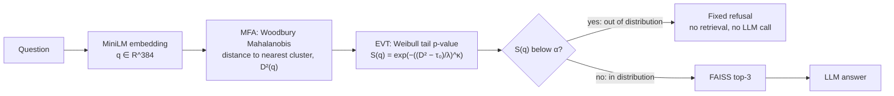

**Research questions:**
1. Does the MFA density separate in-distribution (ID) from out-of-distribution (OOD) questions, and how does it compare with simpler detectors?
2. Does EVT give a calibrated, usable decision threshold?
3. Does the guardrail reduce hallucinations in an end-to-end RAG system, and at what cost to genuine questions?
4. Is it fast enough for real time (< 10 ms)?

## 2. Data

All data is real and public, except one clearly labelled stress-test set.

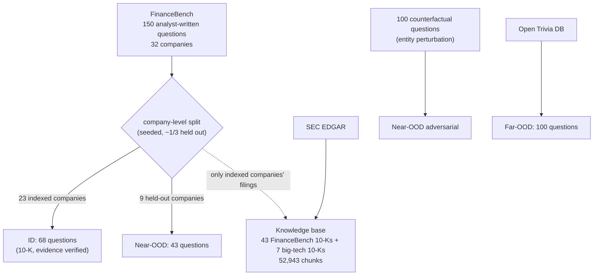

| Set | Size | Source | Notes |
|---|---|---|---|
| **Knowledge base** | 50 10-K filings → **52,943 chunks** | [SEC EDGAR](https://www.sec.gov/edgar/search/) | 43 filings cited by FinanceBench for the indexed companies, located through EDGAR's [submissions API](https://www.sec.gov/search-filings/edgar-application-programming-interfaces); plus the latest 10-Ks of Apple, Microsoft, Alphabet, NVIDIA, Amazon, Meta and Tesla |
| **ID** | 68 | [FinanceBench](https://huggingface.co/datasets/PatronusAI/financebench) (open subset, CC-BY-NC-4.0) | questions on indexed companies' 10-Ks; kept only if FinanceBench's evidence passage is found in our extracted text (median trigram coverage 97%) |
| **Near-OOD** | 43 | FinanceBench | every question about the 9 held-out companies (AMD, Adobe, Block, Boeing, General Mills, MGM Resorts, Netflix, PayPal, Verizon); none of their filings are indexed |
| **Near-OOD adversarial** | 100 | constructed | counterfactual questions about indexed big-tech companies (e.g. *Apple Car revenue*), built by entity perturbation; a stress test for false premises |
| **Far-OOD** | 100 | [Open Trivia Database](https://opentdb.com/) | general knowledge (games, film, history, science) |

**Processing.** Filings are parsed with BeautifulSoup (the hidden inline-XBRL header, scripts, page numbers and repeated headers are removed; tables are kept row by row), split with LangChain's `RecursiveCharacterTextSplitter` (500 characters, 50 overlap) and filtered (≥ 100 characters, ≥ 8 words, no XBRL/URL debris, no duplicates). Chunks are embedded with [all-MiniLM-L6-v2](https://huggingface.co/sentence-transformers/all-MiniLM-L6-v2) (d = 384, L2-normalised) and split at random **80/20 into 42,355 training and 10,588 validation chunks**. Questions are never used for fitting (except the labelled question-calibration ablation in §4.2).

**Excluded FinanceBench questions:** 34 about indexed companies but citing 10-Q, 8-K or earnings documents (not indexed), and 5 whose evidence passage could not be located in our text. Held-out companies' evidence was also checked against the knowledge base: the 7 partial matches are generic boilerplate (e.g. *"we derive a significant portion of our revenues from a limited number of…"*), not the facts asked about.

Data walkthrough: [notebook 01](https://github.com/GellaNagaSaiKrishna/Hallucination-Guardrails-via-MFA-and-EVT/blob/main/notebooks/01_data_pipeline.ipynb).

## 3. Method

### 3.1 Mixture of Factor Analyzers

📓 [notebooks/02_mfa_training.ipynb](https://github.com/GellaNagaSaiKrishna/Hallucination-Guardrails-via-MFA-and-EVT/blob/main/notebooks/02_mfa_training.ipynb) · code: [src/mfa.py](../src/mfa.py), [src/woodbury.py](../src/woodbury.py)

Each of K clusters explains a 384-dimensional embedding by r ≪ d latent factors plus independent noise:

```
x = μ_k + W_k y + ε,   y ~ N(0, I_r),   ε ~ N(0, Ψ_k),   Ψ_k diagonal
p(x) = Σ_k π_k N(x | μ_k, W_k W_kᵀ + Ψ_k)
```

The low-rank part `W_k W_kᵀ` captures the r strongest correlated directions of a cluster; `Ψ_k` keeps the covariance invertible. This needs about d·r + 2d parameters per cluster instead of d(d+1)/2 for a full covariance.

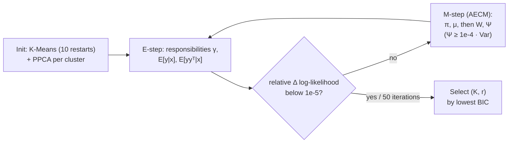

EM is implemented from scratch in NumPy; no d × d matrix is ever formed. The **Woodbury identity** gives the Mahalanobis distance through an r × r Cholesky factor:

```
Σ⁻¹ = Ψ⁻¹ − Ψ⁻¹W (I + WᵀΨ⁻¹W)⁻¹ WᵀΨ⁻¹
D²(q) = min_k (q − μ_k)ᵀ Σ_k⁻¹ (q − μ_k)          cost per question: O(K·d·r)
```

Unit tests ([tests/test_core.py](../tests/test_core.py)) check Woodbury against dense inversion (relative error < 1e-9), monotone EM log-likelihood, and that BIC recovers the true K on synthetic data.

**Model selection** used a grid K ∈ {2, 4, 8, 16, 32} × r ∈ {8, 16, 32, 64} (20 fits) with BIC = −2 log L + p ln N.

**Trained model** ([results/models/mfa_selected.npz](../results/models/mfa_selected.npz)):

| Quantity | Value |
|---|---|
| Selected K, r | **K = 16 clusters, r = 64 factors** |
| Training data | 42,355 chunk embeddings, d = 384 |
| EM | converged in 48 iterations (6.7 min on CPU) |
| Parameters | **373,263** (a full-covariance GMM with K = 16 would need 1,188,879: −69%) |
| Cluster weights π | 3.5% to 10.1% (no degenerate cluster) |

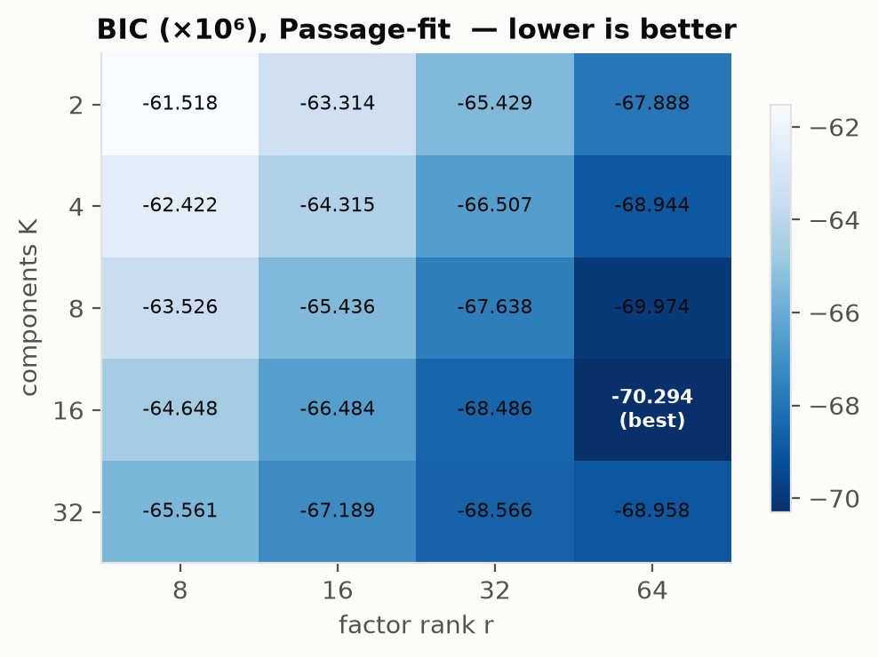

*BIC (×10⁶) over the grid. **Expected shape:** BIC falls as the rank grows (more correlated directions explained) and is U-shaped in K, because extra clusters improve the fit until the parameter penalty p·ln N dominates. **Observed:** every row improves up to r = 64, and in K the optimum is K = 16; at K = 32 the 746k-parameter model is penalised more than it gains. The optimum lies on the edge of the rank grid, so a rank above 64 may fit better still. The pilot on 7 companies selected K = 2: covering ~40 companies creates many more topic clusters.*


*EM convergence of the selected model. **Expected shape:** a monotone, concave increase (EM can never decrease the likelihood), fast at first and then flattening. **Observed:** exactly that; the relative change fell below 10⁻⁵ after 48 iterations. Some larger grid points stopped at the 50-iteration cap; their BIC is therefore slightly pessimistic, which does not change the selected model.*

### 3.2 Extreme Value Theory calibration

📓 [notebooks/03_evt_calibration.ipynb](https://github.com/GellaNagaSaiKrishna/Hallucination-Guardrails-via-MFA-and-EVT/blob/main/notebooks/03_evt_calibration.ipynb) · code: [src/evt.py](../src/evt.py)

A threshold read from the empirical 99th percentile rests on very few points. EVT instead models the **whole tail**: by the Pickands–Balkema–de Haan theorem, excesses over a high threshold follow a generalized Pareto law whatever the bulk distribution is. Following the proposal, the excesses are modelled with a Weibull distribution:

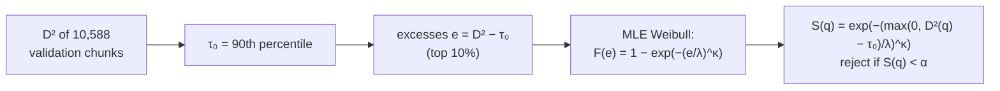

S(q) is a p-value under the hypothesis "q is in-distribution" (conditional on the tail). The rejection threshold in distance units is D* = τ₀ + λ(−ln α)^(1/κ). EVT does not change how questions are *ranked* (S is monotone in D²), so it leaves AUROC unchanged; it only sets the operating point.

**Fitted tail** ([results/models/evt_selected.json](../results/models/evt_selected.json)):

| Parameter | Value | Meaning |
|---|---|---|
| τ₀ | **483.1** | 90th percentile of validation D² |
| exceedances | 1,059 | validation chunks above τ₀ |
| κ (shape) | **1.053** | ≈ 1: an approximately exponential tail |
| λ (scale) | **50.85** | spread of the tail |
| KS test | p = 0.57 (plain), **p = 0.16** (parametric bootstrap, 1,000 refits) | Weibull fit not rejected |
| Threshold D* | **700.0** at α = 0.01, 595.4 at α = 0.1 | 684 / 721 at α = 0.01 if τ₀ is the 85th / 95th percentile |

The plain KS p-value is optimistic because κ and λ are estimated from the same points; the bootstrap version refits the Weibull on every simulated sample and is the one to rely on.

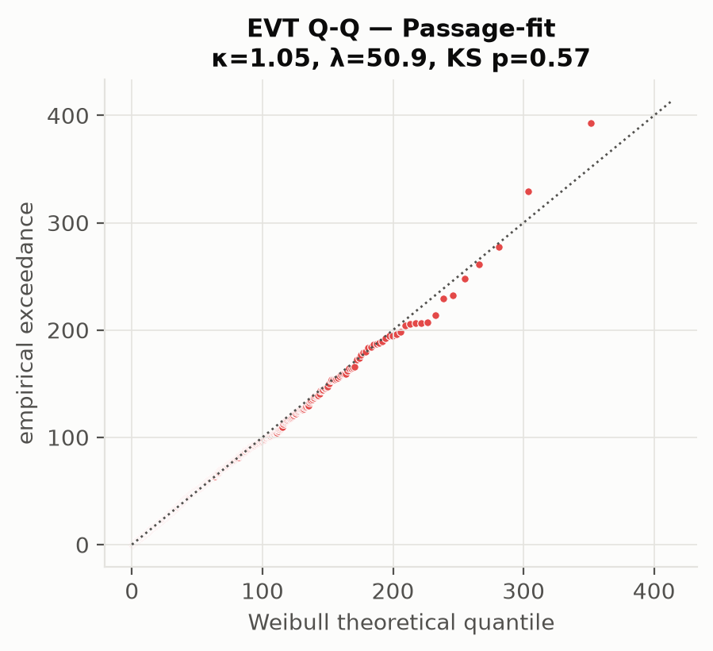

*Q–Q plot of the 1,059 exceedances against the fitted Weibull. **Expected shape:** points on the diagonal if the tail model is right. **Observed:** the points follow the diagonal closely up to the 99.9th percentile; only the last few extreme points deviate, which is normal sampling noise in the extreme tail.*

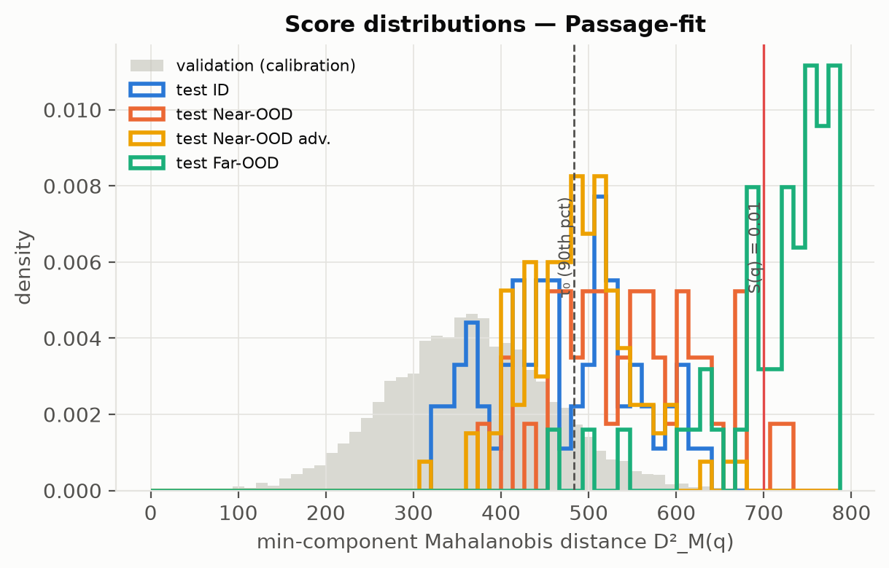

*Distances D² for the validation chunks (grey) and the test questions. **What to look for:** ID questions should sit with the validation data, OOD questions to the right of it. **Observed:** the medians are validation 364, ID 466, Near-OOD adversarial 490, Near-OOD 548 and Far-OOD 793. Far-OOD lies almost entirely beyond the α = 0.01 line (D* = 700). Near-OOD is shifted right but overlaps ID. The adversarial set sits on top of ID, because it is phrased about indexed companies. ID questions are themselves further out than passages (466 vs 364): questions and passages are written differently (query–passage asymmetry), which is why a passage-calibrated α must be chosen with care.*

## 4. Results

**Baselines** (all fitted on the same training chunks, K = the MFA's K): cosine similarity to the nearest chunk (FAISS), Euclidean distance to the nearest K-Means centroid, diagonal-covariance GMM, full-covariance GMM, and a single Gaussian with Ledoit–Wolf shrinkage. **Metrics:** AUROC (OOD = positive class), FPR@95%TPR (share of OOD questions still accepted when 95% of ID questions are accepted; lower is better), and operating points. Full tables: [notebook 04](https://github.com/GellaNagaSaiKrishna/Hallucination-Guardrails-via-MFA-and-EVT/blob/main/notebooks/04_benchmarking.ipynb), [results/](../results/).

### 4.1 Detection

**Table 1. AUROC (higher is better) and FPR@95%TPR (lower is better).** 68 ID questions vs 43 Near-OOD, 100 adversarial and 100 Far-OOD questions.

| Method | AUROC all | AUROC **Near-OOD** | AUROC adversarial | AUROC Far-OOD | FPR@95 Near ↓ |
|---|---|---|---|---|---|
| **MFA + EVT (proposed, ranks by D²)** | 0.767 | **0.736** | 0.559 | 0.988 | 0.70 |
| MFA negative log-likelihood | 0.792 | **0.756** | 0.608 | 0.991 | 0.74 |
| Cosine NN (FAISS) | 0.841 | 0.662 | 0.762 | 0.996 | 0.84 |
| K-Means Euclidean | 0.770 | 0.481 | 0.669 | 0.996 | 0.84 |
| Diagonal GMM | 0.769 | 0.507 | 0.656 | 0.994 | 0.81 |
| Full-covariance GMM | 0.797 | **0.772** | 0.619 | 0.986 | 0.77 |
| Single Gaussian (Ledoit–Wolf) | **0.882** | 0.760 | **0.819** | **0.999** | **0.67** |

**Bootstrap 95% confidence intervals** (2,000 resamples of the test questions): Near-OOD AUROC of MFA D² [0.64, 0.83], MFA NLL [0.67, 0.84], cosine [0.56, 0.76]. The paired difference *MFA NLL − cosine* on Near-OOD is **+0.093 [−0.004, 0.190]** (MFA better in 97% of resamples). On the adversarial set, *MFA D² − cosine* is **−0.20 [−0.30, −0.11]**.

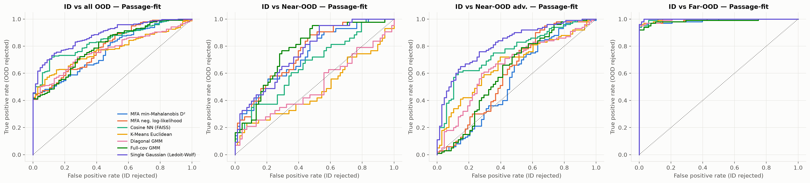

*ROC curves. **What to look for:** a curve hugging the top-left corner is a perfect detector; the diagonal is chance. **Observed:** every method is near-perfect on Far-OOD (right). On Near-OOD (second panel) the covariance-aware models (MFA, full GMM, Ledoit–Wolf) lie well above cosine, K-Means and the diagonal GMM, which are close to chance. On the adversarial set (third) the ordering flips: cosine and Ledoit–Wolf lead and the MFA is near the diagonal.*

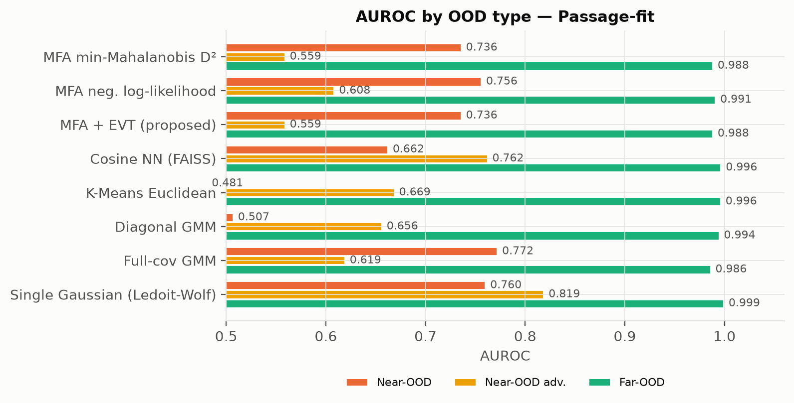

**Why the methods differ:**

- **Covariance matters for Near-OOD.** A question about a company that is not indexed lands near the same financial topics but in a slightly different *direction* of embedding space. Detectors that ignore correlations between dimensions (K-Means: spherical; diagonal GMM: axis-aligned) cannot see this and score close to chance (0.48–0.51). Covariance-aware detectors reach 0.74–0.77. Cosine NN (0.66) suffers because some chunk of *another* company is always close in wording.
- **False premises are a different failure.** Adversarial questions (*"Apple Car revenue"*) are about indexed companies in their usual vocabulary, so their density is ID-like (median D² 490 vs 466 for ID), and the MFA cannot flag them. Cosine NN does better because the invented entities (*holographic eyewear, nuclear-fusion data centers*) have no close chunk.
- **Full covariance is affordable here.** With 42k points in 384 dimensions (110 points per dimension), full covariances are well estimated, so the full GMM and Ledoit–Wolf match or beat the MFA. The MFA's advantage, 69% fewer parameters and no d × d algebra, matters when data per cluster is scarce or d is larger.
- **Likelihood beats distance.** The MFA's full log-likelihood, which also uses each cluster's volume and weight, is better than the minimum Mahalanobis distance on every split.

### 4.2 Operating points

EVT sets the threshold. **Table 2** compares the proposed rule at several α with each baseline thresholded at its 99th validation percentile (a 1% false-alarm budget on passages).

| Rule | ID pass ↑ | Near-OOD rejected ↑ | Adversarial rejected ↑ | Far-OOD rejected ↑ |
|---|---|---|---|---|
| MFA + EVT, α = 0.01 (proposal) | **100%** | 4.7% | 0% | 84% |
| **MFA + EVT, α = 0.1** | 92.6% | **32.6%** | 5% | **97%** |
| MFA + EVT, α = 0.5 | 70.6% | 58.1% | 27% | 98% |
| MFA + EVT question-calibrated, α = 0.1 (3-fold CV) | 92.6% | 30.2% | 4% | 97% |
| Cosine NN, val 99th pct | 72.1% | 44.2% | 64% | 100% |
| Full-cov GMM, val 99th pct | 76.5% | 58.1% | 29% | 98% |
| Ledoit–Wolf, val 99th pct | 98.5% | 18.6% | 21% | 98% |
| K-Means, val 99th pct | 100% | 7.0% | 5% | 95% |

α = 0.01 never blocks a genuine question and stops most trivia, but lets almost all Near-OOD through. **α = 0.1 is the better trade-off**: 7% of ID questions are refused, a third of Near-OOD and 97% of Far-OOD are stopped. Calibrating the tail on ID questions instead of passages gives the same operating point, so the passage calibration transfers reasonably to questions on this data (unlike in the pilot).

### 4.3 Downstream hallucination reduction

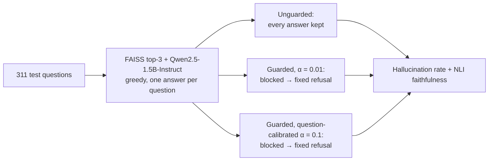

Each question is answered once (FAISS top-3 + [Qwen2.5-1.5B-Instruct](https://huggingface.co/Qwen/Qwen2.5-1.5B-Instruct)), and the guarded conditions replace the answers of blocked questions with the fixed refusal. Every difference between conditions is therefore caused by the gate.

Two system prompts were used:
- **strict:** "answer only from the context, otherwise say *I don't have information about this*" (all 311 questions);
- **naive:** "use the provided context to answer", the common default template (the 243 OOD questions).

**Metrics:**
- **Hallucination rate:** the share of OOD questions that receive a substantive answer. The knowledge base cannot support any such answer.
- **Faithfulness:** the share of answer sentences entailed by a retrieved chunk, judged by [NLI](https://huggingface.co/cross-encoder/nli-deberta-v3-base).

**Table 3. End-to-end results.**

| Prompt | Metric | Unguarded | Guarded α = 0.01 | Guarded, question-calibrated α = 0.1 |
|---|---|---|---|---|
| naive | **Hallucination rate, all OOD** | **44.4%** | **20.2%** | **14.8%** |
| naive | Near-OOD / adversarial / Far-OOD | 72% / 10% / 67% | 72% / 10% / 8% | 58% / 9% / 2% |
| naive | Unsupported answers (NLI), all OOD | 38.3% | 16.9% | 12.3% |
| strict | **Hallucination rate, all OOD** | **11.5%** | **9.5%** | **7.4%** |
| strict | Near-OOD / adversarial / Far-OOD | 44% / 4% / 5% | 44% / 4% / 0% | 33% / 4% / 0% |
| both | OOD questions never reaching the LLM | 0% | 35.4% | 46.9% |
| strict | ID questions wrongly blocked | 0% | **0%** | 7.4% |
| strict | ID faithfulness (answered) | 0.43 | 0.43 | 0.43 |

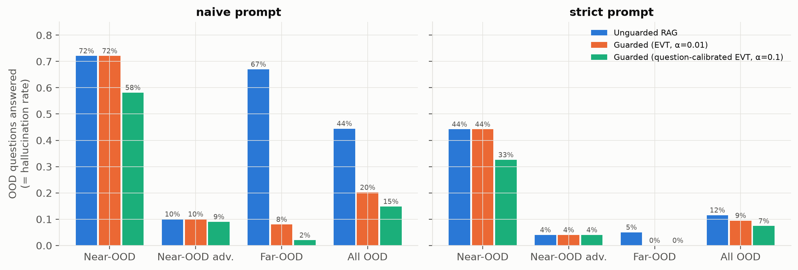

*Share of OOD questions that get a substantive answer. **What to look for:** guarded bars (orange, green) should be lower than unguarded (blue) without blocking ID questions. **Observed:** with the naive prompt the guardrail removes almost all Far-OOD hallucinations (67% → 8% → 2%) and cuts the overall OOD hallucination rate by two-thirds (44% → 15%). The question-calibrated gate also removes a fifth of the Near-OOD hallucinations (72% → 58%). Adversarial false-premise questions are not affected, consistent with §4.1.*

**Findings:**
- **Real Near-OOD questions are the dominant risk.** Even with the strict prompt, the LLM answers 44% of questions about non-indexed companies, typically by reporting another company's figures. A prompt instruction alone does not prevent this; the guardrail at α = 0.1 lowers it to 33%.
- **At α = 0.01 the guardrail is free:** no ID question is blocked and ID faithfulness is unchanged, while all-OOD hallucinations halve under the naive prompt (44% → 20%).
- **Cost and determinism:** 35–47% of OOD questions never reach the LLM, saving the full generation cost for them, and their refusal does not depend on the LLM following instructions.
- **Absolute ID quality is low** (47% answered, faithfulness 0.43) because FinanceBench is hard for a 1.5B model with top-3 MiniLM retrieval. The guardrail does not change it, since it acts before retrieval.

*Measurement note:* refusals are detected with a regular expression over refusal phrases. Answers were generated in fp16 on a Kaggle T4 GPU with greedy decoding.

### 4.4 Latency

**Table 4. Per-question cost on CPU** (K = 16, r = 64, d = 384; 1,000 questions).

| Component | p50 (ms) | p95 (ms) |
|---|---|---|
| **Woodbury MFA scoring (guardrail)** | **0.77** | **1.45** |
| Dense pre-computed precision matrices | 1.01 | 2.09 |
| Naive: build and invert Σ_k for every question | 2,913 | 3,258 |
| Query embedding (MiniLM, for reference) | 7.7 | 15.4 |

The guardrail costs **1.45 ms at p95, well under the 10 ms target**: about 2,000× faster than naive inversion, and faster than multiplying by pre-computed dense d × d precision matrices (Woodbury needs O(K·d·r) operations instead of O(K·d²)). It adds less than the embedding step that every RAG system already pays.

## 5. Discussion and limitations

**What worked.**
- **Far-OOD is solved:** AUROC ≥ 0.99 for every method, and 97% rejected at α = 0.1.
- **On real Near-OOD questions** (companies not in the knowledge base), the MFA clearly beats the detectors that ignore covariance and is ahead of cosine similarity, although the confidence interval of that gap just touches zero.
- **EVT gives a well-fitting, interpretable tail model** (bootstrap KS p = 0.16, 1,059 exceedances) and a threshold that is stable to the choice of τ₀ (±3%).
- **The guardrail is fast:** 1.45 ms p95.

**What did not.**
- **False premises are not detectable from embedding density.** The adversarial set (questions about indexed companies' non-existent products or deals) looks in-distribution, and the MFA is close to chance on it. Detecting false premises needs evidence-level checks after retrieval: answerability classifiers, NLI between question and retrieved chunks, or LLM judges.
- **The MFA is not the best density model at this scale.** With ~110 training points per dimension, full-covariance models (full GMM, Ledoit–Wolf) are estimable and match or beat it. The MFA's parameter savings (−69%) should matter for higher-dimensional embeddings (768–1,024-d), more clusters, or smaller corpora.
- **α = 0.01 is too permissive** for Near-OOD; α ≈ 0.1 is a better operating point. The proposal's α was a prior choice, not a tuned one.

**Comparison with the pilot.** A pilot version used 7 big-tech filings and LLM-generated questions ([branch `old`](https://github.com/GellaNagaSaiKrishna/Hallucination-Guardrails-via-MFA-and-EVT/tree/old)). There, cosine beat the MFA on Near-OOD (0.894 vs 0.858), because all of its Near-OOD questions were counterfactuals about indexed companies, the case the MFA cannot see. With real FinanceBench questions about non-indexed companies, the ranking reverses.

**Limitations.**
- **Small question sets** (68 ID, 43 Near-OOD) give wide confidence intervals of about ±0.09 AUROC.
- **FinanceBench is hard:** top-3 MiniLM retrieval finds the right filing for only 39 of 68 ID questions, and the 1.5B generator refuses or misreads many answerable ones. Absolute RAG quality is therefore low; the comparison between conditions is what matters.
- **Answers come from a single greedy generation per question**, run in fp16 on a GPU. With sampling, hallucination rates would vary from run to run.
- **Faithfulness is judged sentence by sentence by an NLI model**, which is strict on paraphrased numbers.
- **The selected rank is on the edge of the grid** (r = 64).

**Next steps.** Score with the MFA log-likelihood instead of the minimum distance; combine the density gate with cosine similarity (they fail on different questions); add a post-retrieval answerability check for false premises; test 768-d embeddings, where low-rank covariance should pay off.

## 6. Related work

- **Mahalanobis OOD detection.** Lee et al. (2018), [*A Simple Unified Framework for Detecting Out-of-Distribution Samples and Adversarial Attacks*](https://arxiv.org/abs/1807.03888), NeurIPS. Class-conditional Gaussians on network features with a shared covariance; the Mahalanobis distance is the OOD score. This project replaces the shared covariance with per-cluster low-rank-plus-diagonal covariances (MFA).
- **OOD detection for language models.** Ren et al. (2023), [*Out-of-Distribution Detection and Selective Generation for Conditional Language Models*](https://arxiv.org/abs/2209.15558), ICLR. Fits Gaussians to input and output embeddings of summarisation and translation models, scores with (relative) Mahalanobis distance and abstains on OOD inputs, the closest analogue to this guardrail.
- **EVT for open-set recognition.** Bendale & Boult (2016), [*Towards Open Set Deep Networks*](https://arxiv.org/abs/1511.06233), CVPR (OpenMax). Fits Weibull models to the tails of distances to class means to reject unknown inputs, a direct precedent for the EVT step.
- **Mixture of Factor Analyzers.** Ghahramani & Hinton (1996), [*The EM Algorithm for Mixtures of Factor Analyzers*](https://www.cs.toronto.edu/~hinton/absps/tr-96-1.pdf), Tech. Rep. CRG-TR-96-1.
- **In practice**, RAG systems usually rely on similarity-score cutoffs, cross-encoder rerankers, LLM relevance graders such as Self-RAG ([Asai et al., 2023](https://arxiv.org/abs/2310.11511)) and CRAG ([Yan et al., 2024](https://arxiv.org/abs/2401.15884)), and post-hoc groundedness checks. These are either uncalibrated or expensive; this project tests a cheap, calibrated first layer.

## 7. References and resources

| Resource | Link |
|---|---|
| SEC EDGAR full-text search and filings | https://www.sec.gov/edgar/search/ |
| EDGAR APIs (submissions endpoint used to locate filings) | https://www.sec.gov/search-filings/edgar-application-programming-interfaces |
| FinanceBench dataset (open subset) | https://huggingface.co/datasets/PatronusAI/financebench |
| FinanceBench paper: Islam et al. (2023) | https://arxiv.org/abs/2311.11944 |
| Open Trivia Database | https://opentdb.com/ |
| Embedding model: all-MiniLM-L6-v2 | https://huggingface.co/sentence-transformers/all-MiniLM-L6-v2 |
| Generator: Qwen2.5-1.5B-Instruct | https://huggingface.co/Qwen/Qwen2.5-1.5B-Instruct |
| NLI judge: cross-encoder/nli-deberta-v3-base | https://huggingface.co/cross-encoder/nli-deberta-v3-base |
| FAISS | https://github.com/facebookresearch/faiss |
| RAG: Lewis et al. (2020) | https://arxiv.org/abs/2005.11401 |
| Pilot version of this project (branch `old`) | https://github.com/GellaNagaSaiKrishna/Hallucination-Guardrails-via-MFA-and-EVT/tree/old |

## Appendix: reproducing

```
python scripts/fetch_financebench_filings.py   # FinanceBench 10-Ks from EDGAR
python scripts/build_financebench_dataset.py   # knowledge base + test questions
python -m src.embeddings
python -m src.run_experiments                  # MFA grid, EVT, baselines, figures
python -m src.hallucination_eval               # RAG generation + NLI evaluation
python scripts/build_notebooks.py
python -m pytest -q
```
