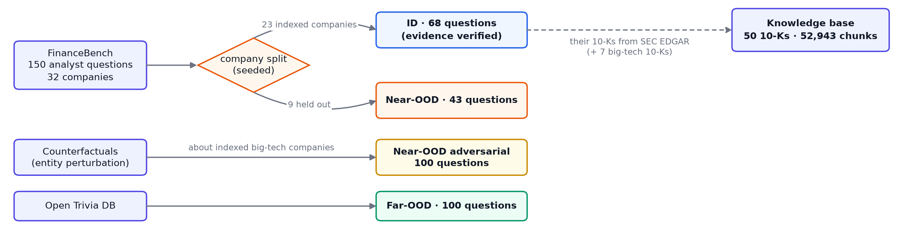
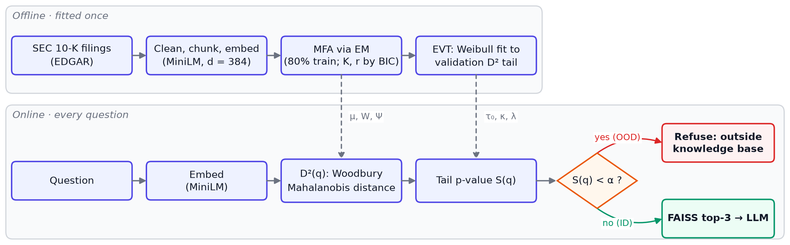
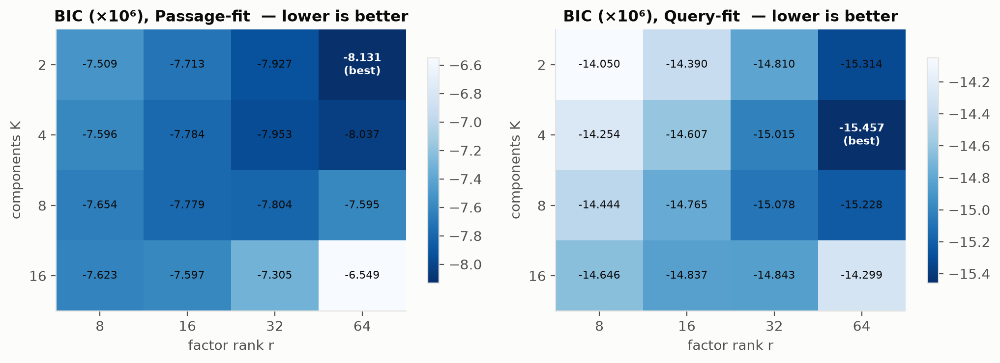
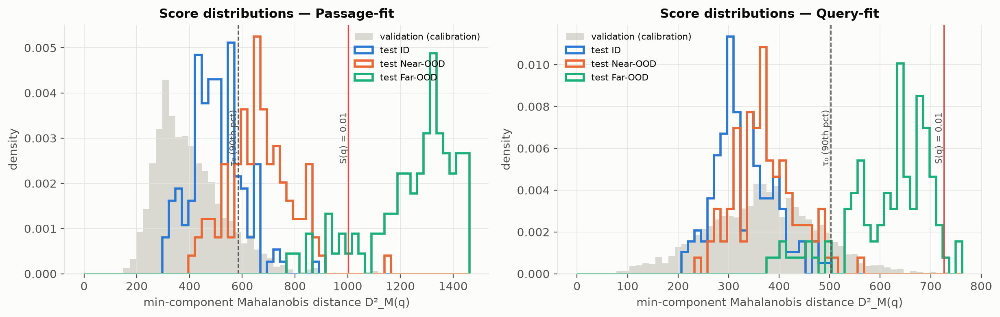
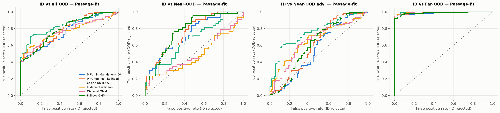
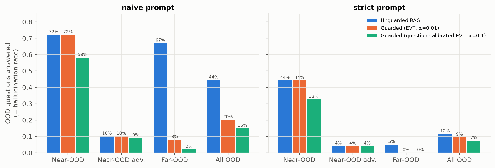

# Hallucination Guardrails via MFA and EVT

> Gella Naga Sai Krishna · Data Science, Semester 5 · November 2026
> **Code:** [github.com/GellaNagaSaiKrishna/Hallucination-Guardrails-via-MFA-and-EVT](https://github.com/GellaNagaSaiKrishna/Hallucination-Guardrails-via-MFA-and-EVT) · **Data:** [SEC EDGAR](https://www.sec.gov/edgar/search/) filings, [FinanceBench](https://huggingface.co/datasets/PatronusAI/financebench) questions, [Open Trivia DB](https://opentdb.com/); processed data in the repository's [data/](https://github.com/GellaNagaSaiKrishna/Hallucination-Guardrails-via-MFA-and-EVT/tree/main/data) folder

## 1. Problem Description

Retrieval-Augmented Generation (RAG) answers a question by retrieving the most similar chunks of a knowledge base and asking a language model (LLM) to answer from them. Nearest-neighbour retrieval always returns *something*, even when the knowledge base cannot answer the question, and the LLM then often writes a fluent, confident, unsupported answer: a **hallucination**. For example, asked for *Adobe's FY2015 operating cash flow ratio* (Adobe is not in our knowledge base), our RAG system retrieved American Water Works' cash-flow table and answered *"1.26"*, another company's number.

The task is to decide, **before retrieval**, whether a question lies inside the knowledge base's distribution, and to refuse it if not. Four kinds of questions must be handled:

| Question type | Example | Correct action |
|---|---|---|
| In-distribution (ID) | *"What is the FY2018 capital expenditure for 3M?"* | answer |
| Near-OOD | *"What drove AMD's operating margin change in FY22?"* (AMD not indexed) | refuse |
| Near-OOD adversarial | *"Apple's revenue from the Apple Car project in 2024?"* (doesn't exist) | refuse |
| Far-OOD | *"Which Mario game first introduced Wario?"* | refuse |

**Requirements:** run in real time (< 10 ms per question), use a statistically calibrated decision threshold rather than a hand-tuned cutoff, and reduce hallucinations end to end without blocking genuine questions.

### 1.1 Data and benchmark

The knowledge base holds 50 SEC 10-K filings (52,943 chunks of 500 characters, 50 overlap): the FinanceBench filings of 23 companies plus the latest 10-Ks of 7 big-tech companies. FinanceBench's 32 companies were split at random: questions on the 23 indexed companies are **ID (68, answer evidence verified in our text)**, and questions on the 9 held-out companies are **Near-OOD (43)**. There are also 100 constructed counterfactual questions (adversarial) and 100 Open Trivia DB questions (Far-OOD). Chunks are embedded with [all-MiniLM-L6-v2](https://huggingface.co/sentence-transformers/all-MiniLM-L6-v2) (d = 384) and split into 42,355 training and 10,588 validation chunks. Test questions are never used for fitting.

<p align="center"><br>
<em>Figure 1. How the knowledge base and the four question sets were built.</em></p>

## 2. Solution Approach

### 2.1 Survey of existing methods

| Method | Stage | Strength | Weakness |
|---|---|---|---|
| Abstention prompt ("answer only from the context") | generation | free | depends on the LLM obeying; fails when the context *looks* relevant |
| Similarity-score cutoff (LangChain, LlamaIndex, vector databases) | retrieval | free, widely used | threshold hand-tuned and uncalibrated; nearest neighbour is easily fooled |
| Cross-encoder reranker with relevance cutoff | post-retrieval | accurate relevance | 10–100 ms per query; threshold uncalibrated |
| LLM relevance grading: Self-RAG ([Asai et al., 2023](https://arxiv.org/abs/2310.11511)), CRAG ([Yan et al., 2024](https://arxiv.org/abs/2401.15884)) | post-retrieval | strong judgement | one or more extra LLM calls, slow and costly |
| Groundedness / NLI checks (e.g. Ragas faithfulness) | post-generation | catches unsupported claims | runs after the expensive generation step |
| Mahalanobis OOD detection: [Lee et al. (2018)](https://arxiv.org/abs/1807.03888); for language models, [Ren et al. (2023)](https://arxiv.org/abs/2209.15558) | pre-retrieval | cheap, principled density score | single shared or full covariance; threshold from a percentile |
| EVT tail models for open-set recognition: OpenMax ([Bendale & Boult, 2016](https://arxiv.org/abs/1511.06233)) | decision | calibrated rejection of unknowns | developed for image classifiers, not RAG |

**Gap:** production RAG relies on uncalibrated cutoffs or expensive LLM judges. This project combines a covariance-aware density model (MFA), fast exact scoring (Woodbury) and calibrated thresholds (EVT) into a cheap first layer that runs before retrieval.

### 2.2 Our approach

<p align="center"><br>
<em>Figure 2. Offline, the MFA is fitted on training chunks and the EVT tail on validation distances. Online, a question's distance becomes a p-value S(q), and the question is refused if S(q) < α.</em></p>

**Mixture of Factor Analyzers** ([notebook](https://github.com/GellaNagaSaiKrishna/Hallucination-Guardrails-via-MFA-and-EVT/blob/main/notebooks/02_mfa_training.ipynb)). Each of K clusters explains an embedding by r ≪ d latent factors plus independent noise, giving a low-rank-plus-diagonal covariance:

```
p(x) = Σ_k π_k N(x | μ_k, W_k W_kᵀ + Ψ_k),     W_k ∈ R^(d×r),  Ψ_k diagonal
```

EM is implemented from scratch: K-Means + PPCA initialisation, E-step factor posteriors, AECM M-step, Ψ floored at 10⁻⁴·Var. BIC over K ∈ {2, …, 32} × r ∈ {8, …, 64} selects **K = 16, r = 64** (48 EM iterations, **373,263 parameters**, 69% fewer than a full-covariance GMM).

**Woodbury scoring.** The distance to the nearest cluster, D²(q) = minₖ (q − μₖ)ᵀ Σₖ⁻¹ (q − μₖ), is computed exactly through an r × r Cholesky factor, Σ⁻¹ = Ψ⁻¹ − Ψ⁻¹W(I + WᵀΨ⁻¹W)⁻¹WᵀΨ⁻¹, at O(K·d·r) per question instead of O(d³).

**Extreme Value Theory** ([notebook](https://github.com/GellaNagaSaiKrishna/Hallucination-Guardrails-via-MFA-and-EVT/blob/main/notebooks/03_evt_calibration.ipynb)). With τ₀ the 90th percentile of validation D², a Weibull distribution is fitted by maximum likelihood to the excesses D² − τ₀. Its survival function gives the p-value S(q) = exp(−(max(0, D²(q) − τ₀)/λ)^κ), and the question is refused if S(q) < α. **Fitted:** τ₀ = 483.1, κ = 1.05, λ = 50.9 on 1,059 exceedances. The fit is not rejected (bootstrap KS p = 0.16). The threshold is D* = 700 at α = 0.01 and 595 at α = 0.1.

<p align="center"> <br>
<em>Figure 3. Left: BIC improves with rank and is U-shaped in K, with the optimum at K = 16, r = 64. Right: median D² is 364 for validation chunks, 466 ID, 490 adversarial, 548 Near-OOD and 793 Far-OOD; trivia lies beyond the α = 0.01 threshold.</em></p>

## 3. Results

**Baselines** are fitted on the same chunks (K = 16): cosine similarity to the nearest chunk (FAISS), distance to the nearest K-Means centroid, and diagonal and full-covariance GMMs. AUROC is the probability that an OOD question scores higher than an ID question (0.5 = chance).

| Method | AUROC Near-OOD | AUROC adversarial | AUROC Far-OOD | AUROC all |
|---|---|---|---|---|
| **MFA + EVT (proposed)** | **0.736** | 0.559 | 0.988 | 0.767 |
| MFA log-likelihood | **0.756** | 0.608 | 0.991 | 0.792 |
| Cosine NN (FAISS) | 0.662 | **0.762** | **0.996** | **0.841** |
| K-Means Euclidean | 0.481 | 0.669 | **0.996** | 0.770 |
| Diagonal GMM | 0.507 | 0.656 | 0.994 | 0.769 |
| Full-covariance GMM | **0.772** | 0.619 | 0.986 | 0.797 |

<p align="center"><br>
<em>Figure 4. ROC curves per OOD type: the closer to the top-left, the better.</em></p>

- **Far-OOD is solved** by every method (AUROC ≥ 0.986).
- **On real Near-OOD questions, covariance matters.** Spherical K-Means and the axis-aligned diagonal GMM are at chance. The MFA beats cosine similarity by +0.09 (bootstrap 95% CI [−0.004, 0.19], ahead in 97% of resamples). The full GMM is slightly ahead at this data size, with 3× more parameters and a 3× slower fit.
- **False premises look in-distribution**, so the MFA is near chance on the adversarial set; cosine does better because invented entities have no close chunk.

**Operating points.** EVT turns α into a clear safety dial; a larger α is a stricter gate.

| Rule | ID pass | Near-OOD refused | Adversarial refused | Far-OOD refused |
|---|---|---|---|---|
| MFA + EVT, α = 0.01 | **100%** | 4.7% | 0% | 84% |
| MFA + EVT, α = 0.1 | 92.6% | **32.6%** | 5% | **97%** |
| Cosine NN, 99th validation percentile | 72.1% | 44.2% | 64% | 100% |

**End-to-end hallucination.** Every question was answered once by FAISS top-3 + [Qwen2.5-1.5B-Instruct](https://huggingface.co/Qwen/Qwen2.5-1.5B-Instruct) (greedy). Guarded conditions replace blocked questions' answers with a fixed refusal, so every difference comes from the gate. The *naive* prompt says "use the context to answer"; the *strict* prompt says "answer only from the context". Faithfulness of ID answers is judged by an NLI model.

| | Unguarded | Guarded α = 0.01 | Guarded α = 0.1 |
|---|---|---|---|
| **Hallucination rate, all OOD (naive prompt)** | 44.4% | **20.2%** | **14.8%** |
| Near-OOD / adversarial / Far-OOD (naive) | 72% / 10% / 67% | 72% / 10% / 8% | 58% / 9% / 2% |
| Hallucination rate, all OOD (strict prompt) | 11.5% | 9.5% | 7.4% |
| ID questions wrongly blocked | 0% | **0%** | 7.4% |

<p align="center"><br>
<em>Figure 5. Share of OOD questions answered (= hallucinated) without and with the guardrail.</em></p>

The guardrail halves OOD hallucinations under the naive prompt with no genuine question blocked (α = 0.01), and removes two-thirds at α = 0.1. Near-OOD questions remain the main risk: even with the strict prompt, the LLM answers 44% of them using another company's figures, and the guardrail lowers this to 33%. **Latency:** 0.77 ms (p50) / 1.45 ms (p95) per question on CPU, about 2,000× faster than inverting each covariance per question and less than the 7.7 ms MiniLM embedding that RAG already pays.

## 4. Conclusions

| Question | Answer |
|---|---|
| Does the MFA density separate ID from OOD? | Far-OOD: yes (AUROC 0.99). Real Near-OOD: yes, better than cosine and shape-blind models (0.74–0.76). False premises: no (0.56) |
| Does EVT give a usable threshold? | Yes: the Weibull tail fits (bootstrap KS p = 0.16), and α = 0.1 balances 92.6% ID pass against 97% Far-OOD refused |
| Does it reduce hallucinations? | Yes: 44% → 20% of OOD questions (α = 0.01, no genuine question blocked), and 15% at α = 0.1 |
| Is it fast enough? | Yes: 1.45 ms at p95, against a 10 ms target |

- **False-premise questions about indexed companies cannot be detected from the question's embedding.** They need a post-retrieval answerability or NLI check, so the guardrail is best used as a cheap first layer rather than a complete solution.
- **Limitations:** small question sets (68 ID, 43 Near-OOD; AUROC CIs ≈ ±0.09); a small generator and retriever (the right filing is retrieved for 39 of 68 ID questions); one greedy answer per question; the selected rank lies on the grid edge.
- **Future work:** score by MFA log-likelihood, combine the density gate with cosine similarity, add a post-retrieval check, and test 768-d embeddings, where the low-rank model should pay off.

## Code and data

| Resource | Link |
|---|---|
| Source code (MFA, Woodbury, EVT, guardrail, evaluation) | [github.com/GellaNagaSaiKrishna/Hallucination-Guardrails-via-MFA-and-EVT](https://github.com/GellaNagaSaiKrishna/Hallucination-Guardrails-via-MFA-and-EVT) |
| Notebooks (data, MFA, EVT, benchmark, demo) | [notebooks/](https://github.com/GellaNagaSaiKrishna/Hallucination-Guardrails-via-MFA-and-EVT/tree/main/notebooks) |
| Processed data (chunks, embeddings, test questions) and results | [data/](https://github.com/GellaNagaSaiKrishna/Hallucination-Guardrails-via-MFA-and-EVT/tree/main/data) · [results/](https://github.com/GellaNagaSaiKrishna/Hallucination-Guardrails-via-MFA-and-EVT/tree/main/results) |
| Raw filings | [SEC EDGAR](https://www.sec.gov/edgar/search/) |
| Questions | [FinanceBench](https://huggingface.co/datasets/PatronusAI/financebench) (CC-BY-NC-4.0) · [Open Trivia DB](https://opentdb.com/) |
